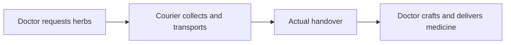

# IntentWeave · 意织

[English](README.en.md) | [简体中文](README.md)

[](https://github.com/loyce-cheng/IntentWeave/actions/workflows/ci.yml)
[](https://github.com/loyce-cheng/IntentWeave/releases/latest)

**Watch NPCs plan, cooperate, and adapt when the world changes.**

IntentWeave is an observable NPC planning playground. A doctor needs herbs; a courier chooses how to collect and deliver them. What happens when a bridge closes, a competitor takes the supplies, or an order is cancelled? Change the world yourself, then inspect what each actor knows, what it plans to do, and why its plan changes.

[Latest release](https://github.com/loyce-cheng/IntentWeave/releases/latest) · [Try it in three steps](#try-it-in-three-steps) · [Python SDK](docs/SDK.md)



- **Independent knowledge, a shared task.** Two actors plan independently. Messages can arrive late; expected deliveries never count as inventory.
- **Intervene and inspect recovery.** Block roads, remove materials, cancel orders, or interrupt actions. Compare Full replanning with Local plan repair.
- **Save the process and verify the result.** Export recordings, verify replay, and continue from a selected cursor while retaining resource use and planning budgets.

Version **0.5.0** supports two planning actors, one rule-based competitor, and one transport work order. It uses local symbolic planning by default: **no API key required**. The cooperation scenario runs entirely offline.

<details>
<summary>Actual interface: handover complete, doctor crafting medicine</summary>


</details>

## Quick start

Requires Python 3.11+ and Node.js 22.12+. Clone the project, then follow the instructions for your platform:

```bash
git clone https://github.com/loyce-cheng/IntentWeave.git
cd IntentWeave
```

macOS / Linux:

```bash
python3 -m venv .venv
.venv/bin/python -m pip install -r requirements-lock.txt
.venv/bin/python -m pip install --no-deps -e .
npm --prefix web ci
npm --prefix web run build
.venv/bin/intentweave serve
```

Windows PowerShell (virtual environment activation is not required):

```powershell
py -3 -m venv .venv
.\.venv\Scripts\python.exe -m pip install -r requirements-lock.txt
.\.venv\Scripts\python.exe -m pip install --no-deps -e .
npm --prefix web ci
npm --prefix web run build
.\.venv\Scripts\intentweave.exe serve
```

Open the [local demo](http://127.0.0.1:8000). The interface currently uses Chinese labels and starts in the single-actor scenario, **单角色送药**. Select **双角色协作** for the cooperation scenario. [HTTP API documentation](http://127.0.0.1:8000/docs) is available while the server is running.

## Try it in three steps

1. Step through the cooperation scenario. Switch the focused actor (**关注角色**) to inspect the doctor's and courier's separate messages, inventories, and plans.
2. Block a road or cancel an order during handover. Inspect waiting reasons and events. Crafting consumes herbs when it starts; interruption does not refund them.
3. Save or export a recording. Restore it, choose a cursor, and select **从此处继续** to continue. The original archive stays intact, and the new branch retains previous resource consumption and budget use.

Expand **新协作场景配置** to change the order deadline, message delay, or the tick when the merchant takes supplies. Full / Local comparisons use the same initial state and interventions. Local can spend more validation budget; export the results to inspect the actual outcomes.

Reloading the page creates a new simulation. Explicitly save an archive to retain progress. See [running the service and maintaining archives](docs/SDK.md#运行与存档维护) for persistence, upgrades, and access credentials (Chinese).

## CLI and Python SDK

The offline core and SDK do not require Node.js. After installing the Python dependencies and project:

```bash
.venv/bin/intentweave run --scenario cooperation --output var/cooperation.json
.venv/bin/intentweave replay var/cooperation.json
.venv/bin/intentweave eval --scenario cooperation --output var/comparison.json
```

Both `run` and `eval` inject a bridge closure after tick 1. Omitting `--scenario` selects the original single-actor scenario. The SDK can create cooperation sessions, read the doctor's projection with `session.actor("doctor")`, submit interventions, and save recordings. See the [SDK guide](docs/SDK.md) for examples (Chinese).

## Development and verification

```bash
.venv/bin/python -m pytest -q --cov=worldmind --cov-report=term-missing
npm --prefix web run format:check
npm --prefix web run build
cd web
npx playwright install chromium
npm run test:e2e
```

`build` includes TypeScript checking. Playwright uses a real backend and production frontend build. Set `PLAYWRIGHT_CHROMIUM_EXECUTABLE` to use an existing Chromium installation. On Windows, use the corresponding Python executable path. [CI](.github/workflows/ci.yml) checks the backend on Windows and Linux, and browser behavior on Linux; current results are shown in PR checks.

Run `.venv/bin/python scripts/benchmark_v04.py` to reproduce the fixed cooperation cases. Results go to `var/benchmarks/v0.4`. Historical recordings under `docs/evidence/` are compatibility regression inputs; do not overwrite them with new results. See the [0.5 release notes](docs/RELEASE_V05.md) and [cooperation protocol and initial validation](docs/RELEASE_V04.md) for scope and evidence (Chinese).

`src/worldmind/` contains the runtime and SDK; `web/` contains the interface; `tests/` and `web/e2e/` contain regression tests. For frontend development, run `npm --prefix web run dev` with the backend already running; Vite proxies API requests. Rebuild the frontend after changes when serving the production page.

## Further reading

The following detailed guides are currently in Chinese:

| Guide | Contents |
|---|---|
| [0.5 release notes](docs/RELEASE_V05.md) | Current features, scope, and validation |
| [Cooperation protocol](docs/RELEASE_V04.md) | Work orders, resources, scheduling, failures, and evidence |
| [Single-actor protocol and shared sessions](docs/IMPLEMENTATION.md) | Original scenario semantics, concurrency, archives, and compatibility |
| [Optional model providers](docs/PROVIDERS.md) | Single-actor model proposals, quotas, and protocol validation |
| [Documentation index](docs/README.md) / [Changelog](CHANGELOG.md) | Current guides, historical reports, and original plans |

IntentWeave was previously named Worldmind. The name describes weaving individual intentions into executable cooperation. The Python package and imports (`worldmind`), `WorldmindClient`, old CLI, `WORLDMIND_*` settings, and recording protocol identifiers remain compatible. `intentweave` is the recommended command. The project currently ships as source code and a local demo.
