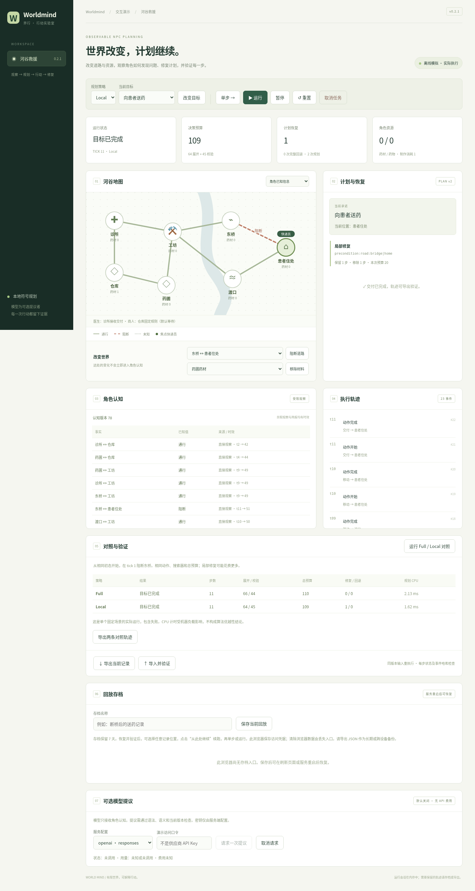

# Worldmind · 界行

可运行、可观察、可验证的 NPC 行动规划演示。角色在有限认知下送药；你可以阻断道路、移除药材、改变目标，查看 Full 重规划与 Local 局部修复的真实结果，并逐步校验回放。

**当前为 0.2.1 开发版本**，改进 Local 搜索复用和短有效期证据下的目标推进，支持从已验证存档的任意游标继续执行。默认不调用模型、不需要 API Key、不产生模型费用。当前交付为源码及本地演示，未部署公开 HTTPS 服务、未验证真实供应商联通。实际验证和负面结果见 [0.2.1 测试报告](docs/TEST_REPORT_V021.md)。

改进分支为 `codex/improve-v0.2`，基于 0.2 最新提交 `dc89e42`；使用该分支获取本版本。升级范围和验证结果见 [本轮报告](docs/TEST_REPORT_V021.md)，变化见 [CHANGELOG](CHANGELOG.md)。



## 快速启动

需要 Python 3.11+、Node.js 22.12+（本轮使用 Python 3.12 / Node 24）。从仓库根目录执行。

macOS / Linux：

```bash
python3 -m venv .venv
.venv/bin/python -m pip install -r requirements-lock.txt
.venv/bin/python -m pip install --no-deps -e .
npm --prefix web ci
npm --prefix web run build
.venv/bin/python -m worldmind.cli serve
```

Windows PowerShell（无需激活脚本）：

```powershell
py -3 -m venv .venv
.\.venv\Scripts\python.exe -m pip install -r requirements-lock.txt
.\.venv\Scripts\python.exe -m pip install --no-deps -e .
npm --prefix web ci
npm --prefix web run build
.\.venv\Scripts\python.exe -m worldmind.cli serve
```

从 0.1 / 0.2 升级时，停止旧服务、更新源码，再重新执行锁定依赖安装、`pip install --no-deps -e .`、`npm ci` 和前端构建；editable 安装也需刷新包版本元数据。保留模型额度账本，备份已有 SQLite 文件。

打开 [本地演示](http://127.0.0.1:8000)。[健康检查](http://127.0.0.1:8000/api/health) 和 [OpenAPI 协议](http://127.0.0.1:8000/openapi.json) 可用于检查服务。先构建前端，再启动后端；单个 FastAPI 服务托管构建产物。修改前端后重新 build。开发时可另运行 `npm --prefix web run dev`，Vite 代理 `/api` 至后端。

核心离线命令不依赖 Node 或浏览器：

```bash
.venv/bin/python -m worldmind.cli run --policy Local --output var/demo.json
.venv/bin/python -m worldmind.cli replay var/demo.json
.venv/bin/python -m worldmind.cli eval --output var/comparison.json
.venv/bin/python scripts/benchmark_v021.py
```

最后一条在 `docs/evidence/v0.2.1` 生成 16 类场景 × 2 个协议版本 × 2 种策略的 64 份校验记录，并完成 120 组固定单扰动对照。旧 `scripts/benchmark_v02.py`、`scripts/evaluate.py` 分别固定历史协议，保留原始实验。结果包含失败/未知，不能视作独立或统计确认实验。

## 五分钟体验

1. 选择 Local 和“向患者送药”，点“单步”。
2. 阻断“东桥 ↔ 患者住处”。世界视图立刻显示阻断；切换“角色已知信息”，远处道路仍显示上次知道的状态。
3. 点运行。快递员到桥边获得新观察后，真实搜索替代路线；制作已经消耗的药材不会回滚。
4. 查看计划恢复、认知来源、动作时间线、展开/校验预算。暂停后可继续单步；制作时取消不会退材料。
5. 运行 Full / Local 对照。两者从相同初态开始，tick 1 阻断同一道路，共用动作模型、搜索器和总预算口径。
6. 导出 JSON；导入时完整重执行校验，随后可从起点逐步验证。损坏文件被拒绝，当前会话不被覆盖。
7. 在“回放存档”区保存记录，刷新页面后从列表恢复；完整验证后可逐步回放，选择记录位置并点击“从此处继续”，再单步或运行；原存档保持不变。服务重启后，只要存档文件仍在且未到期，也可恢复。

缺材例子：重置后移除药圃和仓库材料，再运行，角色在观察确认后报告当前认知下未找到计划。不要把 unknown 解读为真实世界永久无解。

切换规划策略会创建新会话；重置会丢弃当前未保存或未导出的轨迹。活动会话仍在服务重启后丢失；显式保存的回放单独持久化。回放默认只读；“从此处继续”将已验证的前缀转为暂停的可执行分支，保留预算、证据期限、进行中的动作及原记录协议。重置才会开启当前版本的新模拟。单会话最长 500 tick、1500 条输入；服务最多 16 会话，1 小时不活动到期。默认界面仅展示最近 150 条事件，导出保留完整有效输入。

## 持久回放与版本兼容

服务端默认将存档保存在 `var/replay-archives.sqlite3`，可用 `WORLDMIND_ARCHIVES` 改为持久磁盘路径。默认最多 64 份、有效载荷总量 64 MiB，每份最多 2,000,000 字节，保存后 7 天到期。创建时清理过期行并原子检查额度；读取时重新验证协议、内容摘要和每个回放步骤。配额不包含 SQLite 索引和空闲页，不能当作磁盘文件大小上限。

存档有独立访问凭证，服务器只保存凭证哈希；浏览器把存档列表和凭证保存在当前站点的 `localStorage`，不保存模型访问口令。持有凭证即可恢复或删除对应存档，应按私密信息保管。清除浏览器站点数据或换浏览器后，列表不会自动恢复；没有公共存档索引或凭证找回。跨设备使用时，优先导出 JSON。服务端 SQLite 和浏览器凭证都不是云同步，也没有静态加密保证。

新记录标识为 `worldmind-0.2.1/river-1`。0.1 / 0.2 记录使用各自冻结的规划器按原协议重执行，原状态和事件哈希不改写；不支持任意旧版本或未知未来版本。14 份原始 0.1 记录和 18 份原始 0.2 记录逐游标验证。旧记录续跑沿用旧算法；需要新算法时请重置新模拟。活动会话与存档职责分开，恢复存档不会启动后台模拟或重新调用模型。

## Python SDK

同一个 Python 包提供同步 HTTP 客户端，可在另一个脚本中控制已启动的本地服务：

```python
from worldmind.sdk import WorldmindClient

with WorldmindClient("http://127.0.0.1:8000", timeout=10) as client:
    session = client.create_session({"policy": "Local"})
    view = session.step()
    print(view["tick"], view["status"])
    session.delete()
```

SDK 支持会话、动作、控制、导入导出、逐步回放、存档和 `session.resume()` 续跑；不提供模型调用入口，不自动重试或跟随重定向。并发写入冲突通过 `SDKError` 返回。完整示例与凭证生命周期见 [SDK 指南](docs/SDK.md)。

## 可选模型

已实现 19 个配置、5 类协议：Chat Completions、Responses、Messages、Gemini generateContent、Ollama 原生。覆盖 OpenAI、DeepSeek、MiMo、Gemini、Anthropic、方舟、Qwen、Kimi、智谱、聚合平台和本地服务。每个配置的来源、鉴权、参数及限制见 [供应商能力矩阵](docs/PROVIDERS.md)。

没有预填或猜测模型 ID；没有真实凭据时只做协议模拟。JSON/思考模式不通用；模型输出只能成为经过严格校验的动作提议。默认不重试、不跨供应商回退，缺失用量/费用为未知。SQLite 持久账本在请求前占用额度，失败和取消不退款，重启不重置。

配置示例见 [.env.example](.env.example)。**本轮未启用真实调用；后续真实调用需要另行授权。** 获得授权后在持久磁盘执行 `worldmind init-ledger`，配置服务端模型与密钥、至少 24 字符的演示访问口令，再显式设 `WORLDMIND_ENABLE_MODELS=1`。模型开启而账本缺失时服务拒绝启动。`.env` 不自动加载；可导出变量，或使用：

```bash
.venv/bin/python -m uvicorn worldmind.api:create_app --factory --env-file .env --host 127.0.0.1 --port 8000
```

浏览器只输入项目演示口令，不输入供应商密钥。服务严格使用单进程，不加 `--workers`；多实例额度恢复与并发服务不在 0.2 支持范围。

## 验证

```bash
.venv/bin/python -m pytest -q --cov=worldmind --cov-report=term-missing
npm --prefix web run format:check
npm --prefix web run typecheck
npm --prefix web run build
cd web
npx playwright install chromium
npm run test:e2e
```

Playwright 启动实际后端并使用生产构建，不替换业务 API。已有 Chromium 时可设置 `PLAYWRIGHT_CHROMIUM_EXECUTABLE`；云环境本轮使用 `/usr/bin/chromium`。受限沙箱可能需要开放本机线程事件循环/HTTP 所需的网络权限。Windows 对应替换 Python 可执行路径。

[CI](.github/workflows/ci.yml) 配置 Windows/Linux 后端和 Linux 浏览器检查；远程运行状态以 GitHub Checks 为准，配置文件存在不等于运行通过。

## 代码与设计

- `src/worldmind/domain.py`：有限动作模型和输入类型。
- `planner.py`：共享 BFS、连续窗口替换、完整剩余计划校验和预算。
- `engine.py`：权威世界、角色观察、动作执行、事件、导出与回放。
- `providers.py` / `models.py`：协议差异、严格提议校验、持久额度/缓存/审计。
- `sessions.py` / `api.py`：会话生命周期、单写者、幂等命令、后台运行与异步模型代次。
- `archives.py`：独立的 SQLite 回放存储、凭证校验、时效与容量限制。
- `version.py` / `compat/planner_v01.py`：应用版本、记录协议与 0.1 回放分派。
- `sdk.py`：同步 Python HTTP 客户端。
- `web`：TypeScript/Vite 交互工作台与 Playwright 测试。

[当前实现与限制](docs/IMPLEMENTATION.md) · [0.2.1 测试报告](docs/TEST_REPORT_V021.md) · [升级进度](docs/UPGRADE_V02.md) · [0.1 历史报告](docs/TEST_REPORT.md)

Local 的优化结果有明确边界：本轮断桥例子的 Local 预算由 117 降至 102，Full 为 103；缺材例子仍是 Local 109、Full 87。证据有效期设为 3 的检查仍达到 40 tick 上限。下一步应改进证据刷新与修复窗口选择，并扩大冻结场景集；不能把当前少量案例视作普遍优势。

原始构思完整保留：[汇编](Worldmind-完整项目构思与规划.md)、[首版计划](docs/plan/07-两周上线计划.md)、[长期计划](docs/plan/01-项目总规划.md)。旧文档中的未来能力和研究假设不是当前已实现清单。
