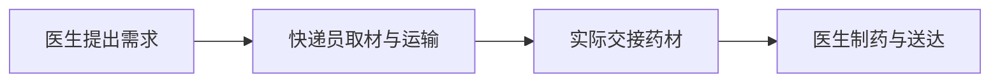
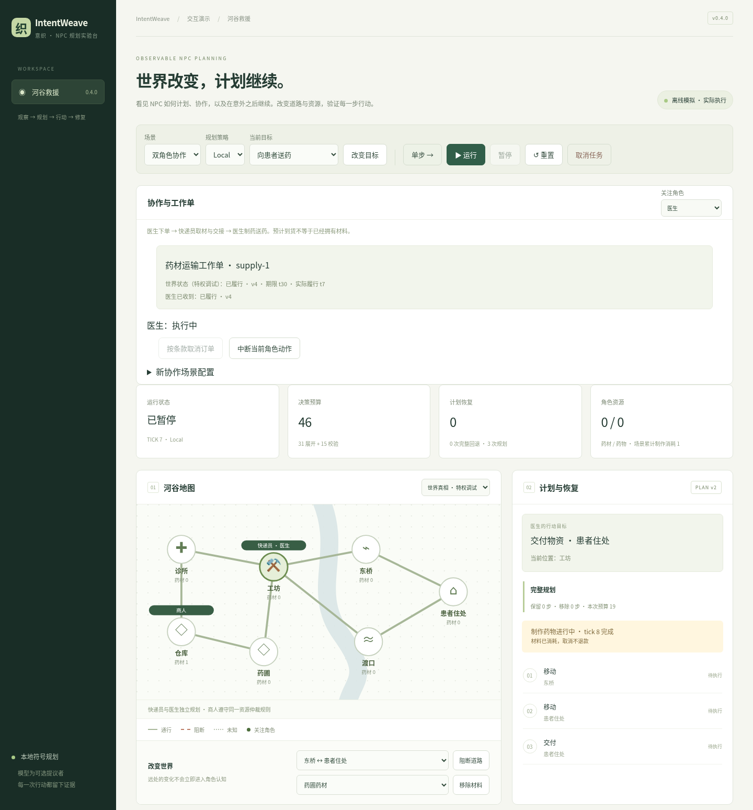

# IntentWeave · 意织

**看见 NPC 如何计划、协作，以及在意外之后继续。**

意织是一个可观察、可干预、可回放的 NPC 规划实验台。医生等待药材，快递员选择路线；如果桥断了、材料被抢先取走，或者工作单被取消，角色会怎样继续？你可以亲手制造这些变化，查看每个角色知道什么、准备做什么，以及计划为什么改变。



- **各自认知，共同任务。** 两个角色独立规划；消息可以延迟，预计到货不能当作现有库存。
- **随时干预，看懂恢复。** 阻路、移除材料、取消订单或中断动作，对照 Full 重规划与 Local 局部修复。
- **保存过程，验证结果。** 导出轨迹、校验回放，并从选定位置继续；材料和预算的消耗随记录保留。

当前 **0.5.0** 提供两个规划角色、一个规则竞争者和一张运输工作单。默认使用本地符号规划，**无需 API Key**；协作场景全部离线运行。

<details>
<summary>查看真实界面：药材交接完成，医生开始制药</summary>



</details>

## 快速启动

需要 Python 3.11+、Node.js 22.12+。在仓库根目录执行：

macOS / Linux：

```bash
python3 -m venv .venv
.venv/bin/python -m pip install -r requirements-lock.txt
.venv/bin/python -m pip install --no-deps -e .
npm --prefix web ci
npm --prefix web run build
.venv/bin/intentweave serve
```

Windows PowerShell（无需激活虚拟环境）：

```powershell
py -3 -m venv .venv
.\.venv\Scripts\python.exe -m pip install -r requirements-lock.txt
.\.venv\Scripts\python.exe -m pip install --no-deps -e .
npm --prefix web ci
npm --prefix web run build
.\.venv\Scripts\intentweave.exe serve
```

打开 [本地演示](http://127.0.0.1:8000)。页面默认进入「单角色送药」；选择「双角色协作」体验本版主场景。[HTTP 接口文档](http://127.0.0.1:8000/docs) 随服务提供。

## 先试这三步

1. 在双角色场景中单步推进，切换「关注角色」，观察医生和快递员各自的消息、库存与计划。
2. 阻断一条道路，或在交接期间取消工作单；查看等待原因和事件记录。制作开始即消耗药材，中断不会退款。
3. 保存或导出回放，恢复后选择游标，再点击「从此处继续」。原存档不变，新分支保留此前的资源消耗和预算。

「新协作场景配置」可调整订单期限、消息延迟和商人取材时点。Full / Local 对照使用相同初态与干预；Local 可能花费更多校验预算，实际结果可导出检查。

刷新页面会新建模拟；需要保留进度时请显式存档。升级、持久化与凭证说明见 [运行与存档维护](docs/SDK.md#运行与存档维护)。

## CLI 与 Python SDK

只运行离线核心或 SDK 不需要 Node.js。安装 Python 依赖和项目后即可执行：

```bash
.venv/bin/intentweave run --scenario cooperation --output var/cooperation.json
.venv/bin/intentweave replay var/cooperation.json
.venv/bin/intentweave eval --scenario cooperation --output var/comparison.json
```

`run` 和 `eval` 均在第 1 tick 后注入断桥；省略 `--scenario` 使用原单角色场景。SDK 可创建协作会话、读取 `session.actor("doctor")`、提交干预并保存回放，示例见 [Python SDK](docs/SDK.md)。

## 开发与验证

```bash
.venv/bin/python -m pytest -q --cov=worldmind --cov-report=term-missing
npm --prefix web run format:check
npm --prefix web run build
cd web
npx playwright install chromium
npm run test:e2e
```

`build` 包含 TypeScript 检查；Playwright 使用真实后端与生产构建。已有 Chromium 可设置 `PLAYWRIGHT_CHROMIUM_EXECUTABLE`；Windows 使用对应的 Python 路径。[CI](.github/workflows/ci.yml) 覆盖 Windows/Linux 后端和 Linux 浏览器，当前结果见 PR Checks。

协作固定案例用 `.venv/bin/python scripts/benchmark_v04.py` 复现，结果写入 `var/benchmarks/v0.4`。历史录制保留在 `docs/evidence/`，用于协议兼容回归；不要用新结果覆盖。0.4 初版的验证结果与适用范围见 [发布说明](docs/RELEASE_V04.md)。

`src/worldmind/` 是运行时与 SDK，`web/` 是交互界面，`tests/` 和 `web/e2e/` 是回归测试。前端开发可运行 `npm --prefix web run dev`，通过 Vite 代理访问已启动的后端；生产页面在修改后需要重新构建。

## 继续了解

| 入口 | 内容 |
|---|---|
| [协作协议与发布说明](docs/RELEASE_V04.md) | 工作单、资源、调度、失败案例与验证 |
| [单角色协议与共享会话机制](docs/IMPLEMENTATION.md) | 原场景语义、并发、存档和兼容边界 |
| [可选模型接入](docs/PROVIDERS.md) | 单角色模型配置、额度与协议验证范围 |
| [文档索引](docs/README.md) / [版本记录](CHANGELOG.md) | 当前指南、历史报告与原始规划 |

IntentWeave（意织）原名 Worldmind（界行），意为把角色意图编织成可执行的协作。为兼容已有安装与存档，Python 包及导入路径 `worldmind`、`WorldmindClient`、旧 CLI、`WORLDMIND_*` 配置和录制协议标识保持有效；`intentweave` 是新的推荐命令。当前交付为源码与本地演示。
