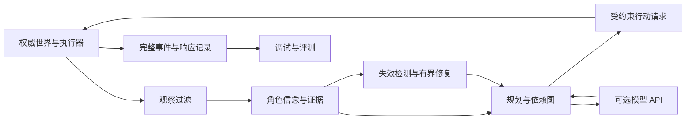
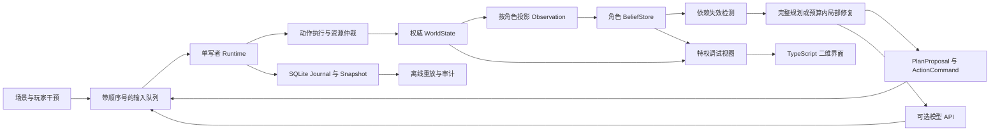
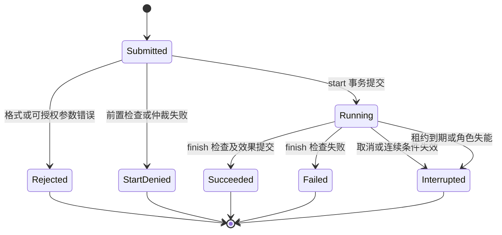

# Worldmind：完整项目构思与规划（汇编版）

汇编日期：2026-10-07。项目暂定中文名：界行。

本文完整汇集此前的方向构思、选题研究、长期项目设计、架构协议、算法、评测和交付路线，并在附录保留两周首版计划，便于作为单个文件阅读和保存。各部分保留原文内容与来源链接，仅调整相对文档链接以适配本文件位置。

**阅读口径：前七部分是完整构思和长期目标；当前首版范围与交付顺序以第八部分的两周计划为准。文中的性能目标、创新假设、工时和拟定功能均为规划，并非已实现或已验证结果。历史原文中的阶段状态描述按各自写作时间理解；本汇编上传不表示运行时代码已经实现。**

本文是当前规划的归档快照，后续实现以 docs/plan 下持续维护的分篇文档为准。

## 目录

- [1．最初构思与方向调研](#part-1)
- [2．完整项目总规划](#part-2)
- [3．架构与协议](#part-3)
- [4．算法与创新验证](#part-4)
- [5．评测与验收](#part-5)
- [6．长期实施路线与工程交付](#part-6)
- [7．场景与演示设计](#part-7)
- [8．附录：两周首版与后续升级](#part-8)

---

<a id="part-1"></a>

## 1．最初构思与方向调研

来源：[开放世界AI项目方向与路线.md](开放世界AI项目方向与路线.md)

**开放世界 AI：个人基础项目选题与实施路线（第一轮）**

调研日期：2026-10-07。用户已确认条件：单人、普通 CPU 笔记本、不运行本地大模型、可以使用付费 API。技术栈、内存、每周投入时间、目标岗位具体 JD 尚未提供。本报告是选题建议与实验计划，所有规模、工期和验收数值均为建议值，没有进行性能实测，也没有产生研究结果。

建议优先选择 **A：可验证的 NPC 行动与计划恢复运行时**。如果更重视容易证明的工程收益，选择 **C：软锁发现与反例复现平台**。B 适合偏内容生产与互动叙事，D 适合偏系统与仿真优化。四项是备选研究主线，不是一个人必须同时实现的功能清单。

**1．选题的出发点：让开放世界的变化产生可持续、可解释的后果。**

可以把未来体验具体化为一个例子：玩家拿走小镇唯一一批药物并破坏桥梁。医生发现缺药后寻找替代来源，商队依据自己获得的消息改变路线，维修者安排材料，玩家接到的救援任务随情况调整。玩家离开小镇后，运输仍在继续；返回后，可以看到同一条事件链造成的后果。

这里需要解决的分别是行动、任务、验证和持续模拟。真正困难的是人物知道什么、动作能否执行、资源是否冲突、事情能否继续，以及计算预算够不够。项目可以只研究其中一个问题，但须提供完整、可复现的解决流程。

这些设想与已有研究方向有交集。DeepMind 的 SIMA 2 研究虚拟世界中的行动智能体，并讨论长程任务、记忆与执行等限制；微软 Project VEGA 展示持续世界中的自主角色与协作。因此，泛化的“NPC 接模型、加记忆、调用工具”本身已不足以构成鲜明贡献。[SIMA 2 官方介绍](https://deepmind.google/blog/sima-2-an-agent-that-plays-reasons-and-learns-with-you-in-virtual-3d-worlds/)、[Project VEGA 官方介绍](https://www.microsoft.com/en-us/research/project/project-vega/)

关于米哈游：2026 年 5 月的报道表述是“未来三年最多投入 1000 亿元”。此次未找到可独立核验该额度的公司正式预算披露，应将其视作媒体转述的投入意向上限，不能说成已经投入或已经落实的预算。[IT之家相关报道](https://www.ithome.com/0/951/364.htm)

米哈游官方招聘网站将 AI 列为技术探索方向。本次官方动态职位详情未能成功加载，因此下文的岗位映射是能力层面的判断，不是对某个在招岗位要求或录用概率的确认。[米哈游招聘官网](https://jobs.mihoyo.com/)

| 候选 | 解决的核心问题 | 可复用的基础成果 | 最适合证明的能力 | 第一阶段的主要风险 |
|---|---|---|---|---|
| A：NPC 行动与恢复运行时 | 计划遇到世界变化后，如何继续合理行动 | 动作协议、观察接口、恢复算法、调试器 | 游戏 AI、Agent 规划与系统工程 | 写成普通工具调用外壳，或过度建设引擎 |
| B：动态任务编译器 | 新任务是否可执行，变化后怎样修复 | 任务表示、验证器、局部修复器 | 规划、约束求解、生成内容工具链 | 任务能完成但无趣；形式模型不准确 |
| C：软锁发现与复现平台 | 哪些合法操作会让任务永久无法完成 | 探索策略、判定器、反例与回归工具 | 搜索、Agent 评测、游戏测试研发 | 状态爆炸、自造缺陷自证 |
| D：多精度世界模拟调度器 | 离屏世界如何在有限预算内持续演化 | 调度器、精度切换协议、误差基准 | 仿真、系统性能、AI 运行基础设施 | 很快但缺少行为意义；近似误差无法度量 |

**2．方向 A：可验证的 NPC 行动与计划恢复运行时。**

**目标用户与问题。** 面向需要接入 AI 角色的游戏开发者。角色通常需要在不完整的信息下做长程决策：采药、加工、搬运、交付，任何一步都可能受到玩家或其他 NPC 干扰。只验证模型输出是不是合法 JSON，无法验证计划是否能完成。

演示可以从三名角色开始：医生、商人、维修者。医生要救治病人，商人运送药材，维修者修复桥梁。玩家可以拿走资源、改变道路、推迟交易。角色需要寻找替代方案；条件确实不允许时，应承认无法完成或等待新的信息。

**一个足够集中的研究问题。** 当角色已观察到的世界条件改变时，能否通过计划依赖追踪，只修复受到影响的子计划，在不降低完成率的情况下，减少重新规划的模型调用与额外行动？多 NPC 的资源冲突用于制造真实扰动，先不把通用社会协作也作为研究目标。

基础模块建议如下：

| 模块 | 必须负责的事情 | 可检查的输出 |
|---|---|---|
| 权威世界与事件日志 | 保存实体、位置、物品、任务和模拟时钟 | 状态快照、事件序列、状态校验值 |
| 观察与信念 | 区分事实、亲眼观察、听闻、过期信息 | 带来源和时间的角色知识记录 |
| 动作协议 | 声明参数、前置条件、效果、耗时、取消条件 | 有效动作及结构化失败结果 |
| 规划器 | 把目标转为技能序列或依赖图 | 可解释的计划与依赖项 |
| 执行器 | 处理动作开始、完成、中断和资源竞争 | 已提交效果、冲突记录 |
| 局部修复器 | 基于角色能获得的信息识别失效部分 | 修复前后差异与代价 |
| 回放与评测 | 重放输入、动作和扰动，比较策略版本 | 失败轨迹、指标、对照报告 |

模型通过 API 理解高层意图、选择技能和提议候选计划。本地 CPU 执行寻路、动作检查、状态变更和实验。动作列表是能力边界，任务组合由规划器产生，不需要为每条完整故事线单独编写脚本。

**关键语义边界。** 世界事实与 NPC 信念分开保存；NPC 可以相信假消息，但不能因此改写世界。执行器使用真实状态检查动作，返回给 NPC 的信息必须符合它当时的感知范围。例如远处物品被拿走，NPC 不应立即得知拿走者身份。计划修复只能由授权观察或可观察的失败触发；调试器可以显示更多信息，决策器不能读取调试信息。

资源转移采用原子效果或受限预留；长动作须明确开始、完成和取消时发生什么，避免预留永久占用。取消不能随意撤销玩家已经见到的历史。API 延迟、超时与过期返回也属于执行失败，旧计划不能覆盖新状态。

局部修复之后，还要在当前可用信息下重新检查剩余计划的资源、时间和角色依赖，防止修好眼前一步却破坏后续步骤。设置修复次数与时间预算，失败时回退到完整重规划或合理等待。有限观察下的验证不等于对真实世界未来的保证，也不承诺全局最优或永不死锁。

**已有工作与差异。** Generative Agents 已提出观察、记忆、反思和规划；Voyager 已使用可执行技能、环境反馈及 API；SayCan 已研究让高层语言计划受到技能可行性的约束。本项目不应将这些组件本身称作原创。拟贡献点是动态游戏中受到信息边界约束的计划修复机制、执行保障及一组可重复的扰动实验。[Generative Agents](https://arxiv.org/abs/2304.03442)、[Voyager 官方仓库](https://github.com/MineDojo/Voyager)、[SayCan 项目页](https://say-can.github.io/)

**实验设计。** 在相同观察、动作和执行检查条件下，比较行为树或目标导向行动规划（GOAP）、LLM 每次完整重规划、LLM 加依赖追踪与局部修复。还必须比较同一个底层规划器的完整重规划与局部修复，避免把更换规划器带来的收益误认为修复算法贡献。不要让所提方案偷偷获得更多世界信息。额外设置移除依赖追踪、移除信念时效处理等消融，检查收益究竟来自哪里。

核心指标是可完成任务的成功率、扰动后恢复有效进展的步数、每次成功的模型调用与 token、额外行动距离、错误信念导致的无效尝试；同时测量从获得相关观察起的计划失效检测延迟与误报。物品重复消费和非法状态提交作为硬约束指标，不能用“拒绝一切动作”换取漂亮结果。对本来就无法完成的场景，另测识别与等待/退出行为。

**第一版边界。** 一个区域、三类角色、约十种动作、三类任务、三种扰动。先三个角色，稳定后扩展至 10–20 个；这不是性能承诺。核心问题成立后再考虑合作分工和信息传播，不先制作完整战斗、语音、美术或大型地图。

**完成形态。** 一个可独立导入的 Python 库、一个简洁二维演示、一个可离线运行的评测命令、一份含负结果的实验报告。浏览器展示每个角色知道什么、计划哪一步失效、如何恢复，比单纯播放一群角色走路更有证明力。

**有 GPU 后的扩展。** 用经过审核的恢复轨迹构造训练数据，蒸馏高层决策策略或训练动作排序模型。当前接口和评测先完成，不把训练作为项目成立的前提。

**3．方向 B：能执行、能检查、能修复的动态任务编译器。**

**目标用户与问题。** 面向任务策划及生成内容系统。世界在变化，生成的任务可能要求已消耗的物品、已经离开的 NPC 或已经关闭的道路；两个分别可完成的任务，也可能争抢一份不可再生的资源。

演示例子：桥断后，系统根据物资短缺生成援助任务。玩家已经取得药材但失去通路，任务允许寻找渡船或修桥；不能为了完成任务把桥偷偷恢复，也不能无说明地把约好的奖励改掉。

**一个足够集中的研究问题。** 世界变化后，能否在保留已向玩家承诺的目标、事实和奖励的约束下，对任务图做较小修改，恢复可执行性？将修改规模、玩家已投入的行动成本和任务结构多样性一起度量。

核心产物是一种任务中间表示：角色和物品引用、启动条件、目标、动作依赖、资源需求、允许失败、补救路径、奖励和不能违背的叙事承诺。流程是“意图或模板 → 候选任务图 → 约束与可达性检查 → 执行 → 变化后的修复”。LLM API 提供候选意图与语言表达；CPU 规划与验证决定哪些候选可以进入游戏。

**已有工作与差异。** CONAN 已根据世界事实和人物偏好进行规划式任务生成；TextWorld 已能生成和控制文本游戏任务。因此新颖性应落在任务并行、运行中扰动、保留承诺的修复及实际引擎一致性，而非“用 AI 生成任务”。CONAN 作者页面还注明部分代码缺失，不能把它当作现成可运行依赖。[CONAN 作者页面](https://jimdavies.org/research/publications/entertainment-computing/2021/BreaultOuelletDavies2021.html)、[TextWorld 官方仓库](https://github.com/microsoft/TextWorld)

**实验设计。** 比较模板、纯 LLM、LLM 加结构检查、LLM 加可执行验证；修复策略再比较全量重新生成、规则补救和保留承诺的局部修复。指标包含初始可完成率、干预后可恢复率、并行任务冲突数、承诺破坏次数、修改节点数、模型成本与结构多样性。必须在实际执行器中跑通任务，而非只检查同一份抽象模型。

“存在一条完成路径”不等于“任意合法行为都不会软锁”；“可以完成”也不等于“好玩”。娱乐性与角色可信度可通过小规模盲评补充，记录人数、评价规则及不确定性，不用模型自评替代玩家评价。

**第一版边界。** 取物、交换、制造三种机制；单区域；少量并行任务；文本与图形界面展示任务图及修复。先做验证内核，再加入生成。建议将核心研究问题限制为资源变化后的任务修复，不同时追求长篇剧情和人物情感系统。

**完成形态。** 任务格式与编译器、策划可理解的错误报告、运行时修复演示、能执行的任务集和实验报告。后续可以服务动态支线、活动内容工具、UGC 关卡验证等用途，实际适配成本需要单独验证。

**有 GPU 后的扩展。** 训练候选任务排序或偏好模型；可执行验证仍然保留，模型评分不取代任务合法性。

**4．方向 C：以软锁为目标的自动探索与反例复现平台。**

**目标用户与问题。** 面向游戏开发与 AI 评测团队。正常通关脚本覆盖不了所有玩法顺序。玩家先消耗唯一材料、同时接互斥任务、在关键事件前读档，可能让游戏仍能操作、任务却永久无法完成，这就是需要检测的一类软锁。

演示例子：系统自动探索“先把唯一矿石制成装备，再接受必须交付矿石的任务”，发现任务无法完成。它输出初始快照、实际动作、首次进入不可恢复状态的位置，以及经过重新验证的精简复现轨迹。修复后同一案例进入回归测试。

**一个足够集中的研究问题。** 能否利用任务和资源之间的依赖，引导探索优先触及危险机制组合，在相同预算内发现更多真实软锁，并产出更短、稳定重现的反例？

基础接口包含 observe、act、reset、snapshot、restore；另有只供检测器读取的特权状态。搜索器用图搜索、覆盖引导或有限预算的树搜索。LLM 可选地提出边界行为，例如“在交付前把任务物品用于制作”，具体动作合法性与最终故障判定由执行器和独立检查器负责。

有限小世界中可以穷举取得真值：某个仍被标为可继续的任务状态，若在所声明规则下没有任何完成路径，才算被证明的软锁。大世界采用有界搜索时，必须区分“已找到完成路径”“已证明无解”“预算内未知”。搜索超时不意味着任务无解。允许失败、重新接取、物品刷新等机制都应进入判定语义。

**已有工作与差异。** iv4xr 已有自动探索、轨迹与断言检查；2024 年研究已将规划与动作模型用于游戏回归；TITAN 已研究 LLM 驱动的 MMORPG 测试。因此项目应聚焦依赖引导、反例缩减与验证可靠性，而不是把自动玩游戏当创新。[iv4xr 官方仓库](https://github.com/iv4xr-project/iv4xr-framework)、[规划与游戏回归测试论文](https://arxiv.org/abs/2402.12393)、[TITAN 论文](https://arxiv.org/abs/2509.22170)

一个值得深入的具体切口来自 FDG 2025 的软锁研究：论文处理移动可达性，并明确未覆盖道具等机制。可以研究任务、资源和人物状态的联合影响，但还需进一步检索才能判断具体方案是否具有论文层面的新颖性。[Stuck in the Middle](https://www.pcgworkshop.com/archive/cooper2025softlocks.pdf)

**实验设计。** 比较随机探索、正常脚本、传统覆盖引导搜索、纯 LLM 决策、依赖引导的混合策略。相同步数预算与相同墙钟预算分别比较，额外报告 API 费用。度量去重后的有效缺陷数、已知缺陷检出率、无缺陷场景误报率、发现时间、重放成功率与轨迹长度。缩短后必须重放，不能把删除操作后的列表直接当作有效反例，也不能把局部缩减称为全局最短。

证据分成三类：合成注入缺陷、外部已知历史缺陷、真实新发现。三类分别统计。按缺陷机制与机制组合留出测试集，仅更换地图随机种子不足以证明泛化。后续至少增加一个独立编写的场景包或外部开源环境适配，检查模型与运行行为的差异。

**第一版边界。** 只测试任务、物品、交互顺序，暂不处理屏幕视觉、真实战斗操作和商业游戏接入。先在纯逻辑环境完成精确检查，再让 Godot 2D 场景重放结果。单个模块是否是真正的 AI 研究，取决于搜索策略和公平实验，而非测试报告界面的功能数。

**完成形态。** 游戏测试适配接口、探索与判定库、独立缺陷集、可重放报告和跨版本回归演示。它是四项中最容易形成明确工程证据的一项，但更偏游戏 AI 测试与评测基础设施。

**有 GPU 后的扩展。** 学习状态表示或探索策略、训练多模态测试代理。既有判定与回放系统可以作为验证基础。

**5．方向 D：保留重要因果关系的多精度世界模拟调度器。**

**目标用户与问题。** 面向持续世界与大量 AI 角色的开发者。玩家视野外的角色若全部冻结，运输、生产和任务都停滞；若全部高频运行，CPU 与模型调用成本迅速上升。单纯按距离降频可能忽视远处却影响当前任务的角色。

演示例子：玩家在甲镇，远处乙镇的药材商队与当前救援任务有关。普通距离调度降低它的精度；依赖感知调度保留关键运输、阻路与交付事件。玩家返回后物品数量、位置与事件时间应与先前承诺一致。

**一个足够集中的研究问题。** 在相同 CPU 和 API 预算下，结合任务依赖分配模拟精度，是否比纯距离策略更能保留玩家相关事件，同时控制近似误差？

核心是离散事件调度、细中粗三档模拟、任务依赖图、精度切换和统一资源账本。近处角色可以逐步寻路，远处角色可按运输事件更新。关键资源仍须遵守相同的转移规则，不能在重新进入视野时编造历史。

**已有工作与差异。** Simulation LOD 是已有思路。Epic 的 MassGameplay 提供模拟 LOD 与不同更新频率，因此创新应落在因果依赖参与预算分配、跨精度状态约束和可测量的成本—误差关系。[Epic MassGameplay 文档](https://dev.epicgames.com/documentation/en-us/unreal-engine/overview-of-mass-gameplay-in-unreal-engine)

**实验设计。** 在可负担的小规模世界，以全细粒度模拟作参考；比较离屏冻结、固定降频、距离 LOD、依赖感知调度。指标包括模拟吞吐、CPU p95 耗时、峰值内存、关键事件漏执行率、到货时间误差及资源守恒违规数。规模扩大后，说明哪些指标仍有参考真值，哪些只能通过不变量和抽样验证。

近似模拟与参考世界的随机性应受控；对于路径不同而最终分布相近的情况，不能仅比较逐步坐标。守恒量要求严格保持，微观轨迹允许近似，两类结论分开报告。

**第一版边界。** 运输与生产两类活动，先几十个细粒度角色，再逐渐增加抽象角色。容量以实测为准，不能预先承诺普通笔记本能运行上万名有意义的 NPC。API 只用于重要事件的高层决策，调度实验本身可以全离线。

**完成形态。** 调度库、跨精度状态协议、性能与误差报告、快速旅行/存读档/反复进出区域的对比演示。它最适合作为 A 成功后的第二条研究线。

**有 GPU 后的扩展。** 学习粗粒度状态转移代理或调度策略，但仍需用可解释的状态约束控制误差。

**6．共同的实现选择与资源控制。**

初始建议为 Python 核心逻辑、SQLite/JSONL 日志、简单二维浏览器回放；已有 C# 基础也可以沿用。先用单进程明确事件顺序，避免把分布式部署当作项目深度。图搜索和状态机足以开始，确有必要时再引入规划或约束求解库；Unified Planning 可作为候选接口，具体后端、许可证与 Windows 支持需在技术选型时逐项确认。[Unified Planning 官方仓库](https://github.com/aiplan4eu/unified-planning)

模型不是每个模拟步都调用。使用事件触发、决策步数上限、并发限制、请求超时和实验预算上限；执行长期动作时使用本地技能。推理内容保存为实验输入，回放读取已保存的结果。重新请求同一个 API 不构成确定性回放。

API 成本估算公式为：总费用 = 输入 token 数 ÷ 1,000,000 × 输入单价 + 输出 token 数 ÷ 1,000,000 × 输出单价，另加所选供应商实际收取的工具等费用。示例工作量：2,000 次决策、每次平均 4,000 输入与 500 输出 token，即约 800 万输入和 100 万输出 token；这是规模示例而非报价或建议直接运行的预算。选定模型后按当时官网价格计算，并先用小样本测量。接受付费 API 不代表已经确定预算。

API 延迟分别计入交互体验与实验墙钟时间，不能用模拟加速掩盖真实等待。优先保留本地有效动作、规则降级与稍后重试的路径。记录模型标识、日期、提示版本、参数、token、实际费用与错误；供应商无法固定模型版本时明确报告。

Godot 支持 headless 模式，可用于后期执行器和无窗口评测。二维显示的硬件需求需本机实测，但核心逻辑应可不渲染运行。不要把“无独显”转化为必须构建复杂云 GPU 环境。[Godot 命令行文档](https://docs.godotengine.org/en/stable/tutorials/editor/command_line_tutorial.html)

TextWorld 是可研究的外部环境，但其官方 README 当前列出 Linux/macOS 原生支持，Windows 使用 Docker 等路径，因此不将它作为当前 Windows 环境的首阶段硬依赖。[TextWorld 安装说明](https://github.com/microsoft/TextWorld#installation)

**7．首推项目 A 的阶段路线。**

暂按每周约 15 小时、已有常规编程基础估算，12–16 周约 180–240 小时可以争取一个收敛的研究原型。该估算不包含从零学习编程、完成通用游戏引擎或保证论文录用。外部游戏适配存在较大不确定性，应单独限时。用户实际投入未知，正式排期需再调整。

| 阶段 | 预估投入 | 工作与交付 | 继续推进的判断 |
|---|---:|---|---|
| 0：问题与反例 | 15–20 小时 | 研究假设、动作表、10 个扰动案例、对照方案 | 不依赖模型，能解释失败原因与成功标准 |
| 1：最小执行环境 | 30–40 小时 | 三 NPC、约十种动作、状态快照、观察隔离、回放 | 同样记录得到相同逻辑结果，守恒与动作语义明确 |
| 2：强基线与 API | 25–35 小时 | 规则规划器、完整重规划策略、调用预算与超时处理 | 基线能完成大部分普通场景，故障不是接口损坏造成 |
| 3：核心方法 | 40–55 小时 | 计划依赖、失效检测、局部修复、对照消融 | 能比较同样任务上的收益与额外开销 |
| 4：独立评估 | 40–55 小时 | 冻结的机制组合测试集、多次运行、独立场景包 | 改进能越过开发案例，失败结论也可解释 |
| 5：交付与复现 | 30–35 小时 | 二维演示、文档、离线命令、完整报告 | 新使用者可依据 README 重放关键结果 |

阶段投入合计约 180–240 小时。若前 30–40 小时仍主要在地图、美术或编辑器上投入，应收缩展示。如果强规划基线已经解决所有测试，先增加合理的未见目标组合和信息扰动，而不是削弱基线。若局部修复不占优，就保留负结果并分析适用区间，不能反复调整测试集直到数字好看。

首轮筛选可以用 10–20 个场景比较方法；冻结后建立约 50–100 个场景变体，并按机制组合留出一部分。在线模型先每场景少量重复评估方差，再依预算决定重复次数，避免没有统计理由地铺大量调用。报告样本量、配对差异与不确定性，不能只挑选最好的一次。

建议的可检查交付条件是：所有声明支持的动作均有语义与失败处理；发布测试中没有已知守恒违规；记录回放稳定；包含至少两种强基线、关键消融和一个独立场景包；能展示成功、失败、不可完成三类结果。研究收益采用完成率与成本的联合比较，不预先承诺提升百分比。

**8．如何把项目成果变成研发能力证据。**

项目最有价值的材料应形成连续链条：具体游戏失败 → 状态与目标定义 → 强基线 → 一项清晰机制 → 公平实验 → 外部或独立验证 → 可重复运行的代码。

| 交付物 | 证明什么 | 避免怎样的误读 |
|---|---|---|
| 状态/动作协议与设计决策 | 能把开放问题建模为可执行系统 | 只有提示词与 API 封装 |
| 失败分类和完整轨迹 | 能观察、诊断和解释 AI 的失败 | 只展示精选成功视频 |
| 基线、消融及成本报告 | 能设计实验、识别真实贡献 | 提升来自更强模型或更多预算 |
| 独立场景与适配接口 | 方案可在开发案例之外使用 | 一个为方法量身定制的玩具世界 |
| 可导入库、命令与文档 | 能交付供别人使用的基础组件 | 只有本机能跑的演示脚本 |

这类项目主要证明游戏 AI/Agent 系统、规划、仿真、评测和工程研发能力。它们不能单独证明大规模预训练、视觉世界模型或强化学习训练能力；若目标 JD 以这些为核心，后续需要另补相应证据。二维、离散模拟的成功也不能直接推广为复杂三维动作控制或商业开放世界的生产可用性。

最后的选题建议保持明确：最希望做玩家可感知的 AI，选 A；最希望形成稳定、量化的工程成果，选 C；最喜欢内容设计与约束推理，选 B；偏好性能与复杂系统，且已有一定仿真基础，再选 D。先完成一个主问题，其他方向保留为可复用接口与后续研究。


---

<a id="part-2"></a>

## 2．完整项目总规划

来源：[docs/plan/01-项目总规划.md](../plan/01-项目总规划.md)

**界行：项目总规划 v0.1**

日期：2026-10-07。状态：设计基线，待实现、待实验验证。已确认条件：单人，普通 CPU 笔记本，无需本地大模型，可使用付费 API。未确认条件：具体 CPU/内存、技术栈熟练度、每周工时、API 金额上限及目标岗位 JD。以下据此采用可调整的默认选择，不把未知条件当作已满足。

**交付顺序更新：先用 AI 辅助开发在两周内发布收敛的 v0.1，再扩展本文所述完整项目。首版范围、工期与版本编号以 [两周上线计划](../plan/07-两周上线计划.md) 为准。本文的完整 1.0 功能不是首版上线前置条件。**

**1．项目的目标与价值。**

建立一个可嵌入小型游戏或研究环境的 NPC 行动运行时，使角色在有限观察、资源竞争、持续世界变化下完成多步目标。它应具有明确的动作语义、可修复计划、失败退路、可审计观察和可重放轨迹，并通过独立实验说明有效范围。

核心研发问题是：当 NPC 的当前计划因新观察或可感知失败而失效时，如何判断哪些步骤受到影响，补充必要观察，在给定计算预算内修复计划，同时尽量保留既有行动投入和向其他角色作出的承诺？

它服务两类使用者：游戏开发者使用运行时构建会做事的角色；研究者使用场景、对照策略和评测工具研究动态环境中的规划恢复。玩家端通过角色的移动、生产、运输、维修和协作感知效果。自然语言是设定意图和解释行为的入口，成功判定依据实际世界效果。

项目完成时应支持：给角色设定“在约定时间前提供药物”这样的目标；玩家改变资源或路线；角色根据可获得的证据发现问题、选择替代路径、询问或观察、处理资源冲突；最后呈现完成、延期、失败或无法判断的明确状态。

**2．什么构成项目的创新。**

创新分为机制、工程和评测三层，均需实验后才能得出结果。不能仅因多个已有组件组合在一起，就声称论文级首创。

| 候选贡献 | 具体设计切口 | 必须提供的证据 | 被否定后如何处理 |
|---|---|---|---|
| 受观察约束的依赖失效检测 | 每个计划条件关联角色可见证据、来源与时效；隐藏变化不得直接进入决策 | 同观测历史的成对世界测试；与普通状态图修复比较 | 若只有接口工程收益，按运行时规范与测试贡献报告 |
| 面向承诺与资源冲突的有界修复 | 修复边界同时考虑因果、资源、时间及已接受工作单；先守硬约束再减少变更 | 同一规划器全量重规划、直接修复、逐项消融；成功率与总成本联合比较 | 修复不总占优，报告适用扰动范围和回退规则 |
| 可重复的游戏恢复评测 | 分离世界真相、角色证据、策略输入、模型响应及执行轨迹；多种时钟协议 | 公开场景格式、基线、完整轨迹和独立适配检验 | 外部场景失败时收窄适用域，不删除不利结果 |

最接近的前例必须正面承认。GAVEL 已研究显式世界图、动作验证和部分修复；BRACE 已研究预算内重规划；ROBUST TAMP 已将可见状态和事件触发规划结合。因此，“图＋校验＋局部修复＋按需调用”不是本项目独有的主张。本项目选择游戏中的多角色资源和承诺依赖、证据边界、可复现实验作为切口，差异能否成立仍待具体比较。[GAVEL](https://arxiv.org/abs/2609.19315)、[BRACE](https://arxiv.org/abs/2608.01428)、[ROBUST TAMP](https://arxiv.org/abs/2608.28075)

详细前例、伪代码与保证边界见 [算法与创新验证](../plan/03-算法与创新验证.md)。预期最终可以形成方法报告或论文投稿材料，但不把发表论文作为项目完成的必要条件，也不承诺研究结果优于已有工作。

**3．完整 1.0 的六类交付。**

| 交付 | 1.0 必须具备的能力 | 可独立使用的方式 |
|---|---|---|
| 运行时 SDK | typed 观察、目标、动作、计划、结果；执行循环；策略替换；本地预算 | Python 包与示例宿主程序 |
| 恢复算法 | 依赖追踪、局部修复、剩余计划检查、观测/等待、全量回退 | 对同样输入替换规划策略 |
| 参考世界 | 有限离散状态、耗时动作、资源流转、并行 NPC、玩家扰动、存读档 | 无窗口命令与交互演示 |
| 调试工作台 | 世界与角色视图、计划差异、证据来源、时间线、回放与成本 | 本地浏览器工具 |
| 评测套件 | 确定性语义测试、机制组合场景、强基线、消融、统计与资源报告 | 无 API 的离线测试及可选在线实验 |
| 最小外部适配 | Godot 2D 宿主承担一组真实交互语义，运行时通过协议驱动 | 参考适配器与契约一致性测试 |

10–20 名逻辑角色是 1.0 的目标工作负载；全部启用高频 LLM 不作为要求。原型只需三名角色，其他竞争者可以采用明确的脚本或规则策略。1.0 才扩展持续并行任务与受限的工作单协作。所有容量、时延及内存目标必须经本机标定。

完整性定义为：能从设置目标、观察、规划、行动、失败、修复一直走到判定和回放，并且组件有可复用接口、错误处理和验证。大量人物设定、地图面积或支持模型数量都不作为完成标准。

**4．明确的功能需求与追踪关系。**

| 编号 | 需求 | 对应证据 | 首次阶段 |
|---|---|---|---|
| FR-01 | 权威世界唯一写入者，转移原子化，消耗/产出有账本 | 守恒、并发争抢与重复命令测试 | P0 |
| FR-02 | 动作含开始、执行、结束、中断及已发生效果 | 各阶段扰动与取消案例 | P0 |
| FR-03 | 角色只收到自身可观察的信息 | 成对世界、元数据泄漏与错误消息测试 | P1 |
| FR-04 | 维护证据来源、时效与三值条件判断 | 过期、矛盾证据、未知条件案例 | P1 |
| FR-05 | 相同接口下支持规则、完整规划和模型辅助规划 | 策略替换及强基线报告 | P1/P2 |
| FR-06 | 局部修复后检查剩余计划，超过预算回退 | 资源、时间、循环等待及回退案例 | P3 |
| FR-07 | 多角色承诺可接受、履行、拒绝、撤销和到期 | 角色间依赖、消息延迟和履约报告 | P4 |
| FR-08 | 异步模型回包不能覆盖过期目标或计划 | 延迟、乱序、重复回包、超时测试 | P2 |
| FR-09 | 状态、事件、随机流、模型响应能记录和回放 | 事件重放与执行重放校验 | P0/P2 |
| FR-10 | 可暂停、单步、干预和比较计划版本 | 调试工具的任务式演示 | P0–P6 |
| FR-11 | 场景格式、基线与统计结果可重复运行 | 冻结评测清单、原始结果和报告 | P3–P6 |
| FR-12 | 引擎适配能发现模型与真实执行差异 | Godot 动作契约及延迟回执测试 | P5 |

**5．系统的基本边界。**

权威状态 S 是世界实际发生的事，观察 O 是角色获准获得的事实，信念 B 是角色根据观察维护的认知。三者不同。未知不等于不存在，消息过期也不意味着消息必然错误。动作执行的可靠性来自权威层检查；认知层不承诺永远知道真实情况。

首版使用线性执行队列，并用有向无环图记录步骤之间的依赖；多角色可以并发执行，但单个角色不同时进行多个占用身体的动作。时间离散化，动作持续整数 tick；未来可增加更复杂约束，当前不实现完整连续物理或通用部分可观测决策求解器。

模型只能返回受限目标或候选技能序列，不生成并执行任意代码。动作参数必须引用角色已知实体，不能通过全局实体列表获得隐藏信息。执行器可以拒绝失败动作，但给角色的失败描述只包含其能够感知的原因。全局日志与调试真相由独立的管理路径读取。



图中调试与评测的数据不可回流到角色策略。API 输入由角色已知信息构造。开发代码内的隔离依靠接口、模块边界和测试；这不是执行不可信第三方代码的安全沙箱。

**6．项目中 AI 的作用与非训练路线。**

模型用于理解未见的目标表述、选择已有技能、提出任务分解与可行备选；符号层负责明确规则下的搜索、验证和执行。目标和计划由运行时组合，不为每条完整流程手写剧情脚本。

应分别检验两件事：恢复机制是否有效；LLM 是否比不使用模型的策略增加能力。若符号规划足够好，诚实保留其优先地位。项目的 AI 研究也包含规划、搜索、部分观察和多智能体协作，不能把 API 调用数量当成智能程度。

GPU 相关扩展独立放到 1.0 之后：审核恢复轨迹、构造训练数据、训练轻量动作排序器或蒸馏高层策略。届时保留同一场景与验收标准，不让训练成为当前主线的前置条件。

**7．不进入 1.0 的内容及扩展顺序。**

1. 连续三维操作、截图理解、语音和表情不进入首版；以结构化动作研究决策恢复。
2. 完整动态剧情编译、大规模模拟 LOD 属于先前的其他项目方向；仅预留目标/事件接口。
3. 通用经济系统、无限资源制造、大地图编辑器、多人联网服务不进入 1.0。
4. 跨 NPC 协作限定为显式工作单及资源交接，保持可验证；自由社交和群体涌现可后续独立研究。
5. 网络商业游戏接入、厂商内部生产可用性、通用游戏 Agent 能力不在当前证明范围。

完成后优先扩展第二个独立领域，再扩大角色数量，然后考虑更多引擎，最后才考虑训练或视觉。每次扩展必须新增可回答的研究问题。

**8．进度与决策门槛。**

约 180–240 小时完成 P0–P3 的研究原型；P4–P6 补齐多角色协议、外部适配、独立评测与发布质量，完整 1.0 基准工作量约 360–510 小时。以每周 15 小时换算为 24–34 周，另建议留 20% 返工缓冲，即约 29–41 周。这些是任务拆分估算，不是交期承诺，也不包含从零学习编程。

阶段能否通过由交付和证据决定。工程合格与研究优越性分开：即使没有稳定超过强基线，也可以交付可靠的运行时、基准和适用范围报告；若核心观察隔离或执行语义不成立，就不能用精美演示替代修复。

技术栈、目录、任务分解和风险详见 [实施路线](../plan/05-实施路线与工程交付.md)；场景与实际展示详见 [场景设计](../plan/06-场景与演示设计.md)；收益判定以 [评测与验收](../plan/04-评测与验收.md) 的冻结协议为准。


---

<a id="part-3"></a>

## 3．架构与协议

来源：[docs/plan/02-架构与协议.md](../plan/02-架构与协议.md)

# 界行 NPC 行动运行时：架构与协议

状态：2026-10-07 设计稿；本文件规定未来实现的接口与语义，不代表代码已经存在或性能已经验证。范围为 Python CPU 核心、SQLite 事件存储、TypeScript 轻量二维调试界面；先跑通医生、商人、维修者三 NPC，再扩展到 10–20 NPC。API 仅提议高层计划，可以完全关闭。

主研究问题是：**在相同受限观察和预算下，追踪计划依赖并局部修复，能否减少恢复代价，同时保持任务完成率。** 本项目不求解完整 POMDP，不实现通用游戏引擎，不把“记忆＋工具调用”作为原创贡献。

## 1. 运行边界与数据流

世界拥有真实状态，角色拥有由合法观察形成的信念。二者不是同一个对象的不同字段视图。规划器只拿到序列化的 ActorContext，不能持有 World、数据库连接或调试服务引用。执行器使用真实状态判断动作，但必须通过观察投影器向角色解释结果。



箭头是授权数据通路。没有 `World → Policy`、`Journal → Policy` 或 `Debug → API` 通路。静态地图可以设为公共常识，但道路当前通断、库存及其他角色目标必须明确声明可见性；公共地图和动态通行信息分离。

| 模块（拟定包） | 输入与输出 | 禁止承担的职责 |
|---|---|---|
| `domain` | 实体、谓词、动作定义、整数时间与数量 | 网络、数据库、UI、模型提示 |
| `world` | 内部命令 → 事件批次 → 新世界状态 | 调用模型、替角色形成信念 |
| `perception` | 世界状态和局部感知规则 → 每角色观察 | 暴露全局事件、未感知对象的存在 |
| `belief` | 观察 → 带来源的信念、差量与失效通知 | 用真实状态纠正角色、隐藏地补齐未知值 |
| `planning` | ActorContext → PlanProposal/RepairResult | 获取全局合法动作或真实最短路径 |
| `execution` | 动作请求 → 开始/完成/中断事件 | 修改已提交历史、让模型直接写状态 |
| `runtime` | 时钟、命令、API 回包 → 确定顺序的状态迁移 | 多线程直接修改世界 |
| `persistence` | 事务日志、快照、清单 → 可恢复运行 | 把数据库全量结果提供给角色 |
| `adapters` | 引擎/模型/展示协议转换 | 绕开核心检查、替换权威语义 |

三 NPC 原型中各模块可以同进程，但通过接口限制导入和引用。该隔离是防止工程误用的机制，不是对任意恶意 Python 插件的安全沙箱；v1 不执行模型生成代码、不支持不可信插件。

## 2. 类型约定与权威世界

所有协议含 `schema_version`。标识符为字符串，不能把数据库自增 ID 当角色可见实体 ID。逻辑时间为非负整数 `tick`，数量、费用微单位和格子坐标为整数；禁止 NaN、无穷、隐式时区或影响游戏逻辑的浮点坐标。字段顺序不具有语义，未识别的执行字段直接拒绝。

`WorldState` 至少包括：`run_id`、`tick`、内部 `world_revision`、实体组件、物品账本、活动动作、资源预留、待执行定时事件、场景公开规则。实体组件包括位置、能力、库存容器、道路状态与任务对象状态。`world_revision` 和世界哈希只用于内部审计，不能出现在 ActorContext 中。

物资账本区分物品的所有者、位置、数量及显式的生产/消耗原因。转移必须两端同一事务提交；数量不可为负；预留是对既有物品的占用声明，不另算一份库存。生产与消耗须有动作规则和事件依据，不能将“全世界物品数量永远不变”误设为制造场景的不变量。

每次状态变更先在候选副本上产生事件、计算新状态并验证不变量，然后提交 SQLite；提交成功后才发布观察和 UI 更新。单写者是唯一可持有写连接和应用 reducer 的对象。API 工作线程只能投递回包，不能访问写连接。

## 3. Observation 与 Belief：事实、未知和过期

角色收到的观察是有限证据，不是全局事件过滤后的原始对象。`actor_seq` 只统计本角色收到的消息，`knowledge_version` 只随本角色证据/信念变化而变化。禁止暴露全局日志位置、全局更新时间、隐藏实体数量等旁路信息。

```json
{
  "schema_version": "1.0",
  "actor_id": "doctor",
  "actor_seq": 18,
  "received_tick": 120,
  "knowledge_version": 9,
  "observations": [{
    "observation_id": "obs-doctor-18-a",
    "kind": "direct",
    "observed_tick": 120,
    "subject": "bridge-east",
    "predicate": "traversable",
    "value": false,
    "source": {"channel": "vision", "source_actor": null},
    "coverage": {"scope": "bridge-east", "complete": true}
  }]
}
```

`direct` 表示亲眼或动作接触获得的证据，`report` 表示角色实际收到的报告，`self` 表示自身动作/物品反馈。报告的内容可以错误；只能提供报告者声称的时间与来源，不能附上权威真值验证结果。观察投影器以事件发生时的感知条件生成观察，不能用数步之后的位置补发“当时目击”。视觉轮询则以采样时刻为准。

BeliefRecord 字段为 `fact_key`、`value`、`status`、`source_observation_ids`、`observed_tick`、`received_tick`、`valid_until_tick`、`confidence_label`、`belief_version`。`status` 取 `supported/conflicted/stale/unknown`；置信度只使用 `direct/reported/inferred` 等证据标签，不冒充校准后的概率。`valid_until_tick` 是对动态事实的工程时效假设，过期只变为 `stale`，不能自动反转真假。历史事实“在 120 tick 看见桥断”不因时效到期而消失。

同一时刻互相矛盾的报告保留为冲突，后收到的旧消息不能覆盖较新的亲眼观察。当前推断值与全部证据分开保存；v1 采用固定、版本化的更新规则，不让 LLM 随意合并证据。未观察不等于不存在：只有明确具有完整覆盖的货架检查，才能推导“此处没有药品”；视野外没有返回对象不产生负证据。

能力目录只列角色学会的静态动作种类、参数、公开规则和已知对象候选，不能返回基于真实库存、道路或他人预留筛选的 `legal_actions`。候选动作由角色自己的信念生成。查询远处物品、全图实际路径和预留状态都不允许作为免费 oracle；需要走近、检查或实际收到消息。

## 4. Goal、Plan DAG 与修复接口

`Goal` 字段为 `goal_id`、`version`、`owner_actor`、`desired_predicates`、`public_constraints`、`priority`、`deadline_tick`、`status`。目标可以由场景合法授予，但文本不能夹带未授权事实。角色按证据判断是否达到目标；独立评估器可以用真实状态判定成绩，两种判断分别记录。

`Plan` 包含线性执行序列 `execution_order` 和旁挂的依赖有向无环图，节点状态为 `pending/ready/running/succeeded/blocked/cancelled`。边区分顺序、因果支持、资源与时间依赖；v1 每角色同时最多一个前台动作，DAG 用于表达依赖与识别待修复区域，不意味着实现任意部分序调度。编译器从候选节点与顺序约束生成确定的执行顺序，算法首版仅替换其中连续窗口。

```json
{
  "schema_version": "1.0",
  "proposal_id": "proposal-doctor-7",
  "actor_id": "doctor",
  "goal_id": "heal-patient",
  "goal_version": 1,
  "base_plan_version": 3,
  "base_knowledge_version": 9,
  "nodes": [
    {"node_id": "inspect", "action": "inspect", "args": {"target": "clinic-shelf"}},
    {"node_id": "take", "action": "take", "args": {"container": "clinic-shelf", "item": "herb", "quantity": 1}}
  ],
  "edges": [{"from": "inspect", "to": "take", "kind": "order"}],
  "assumptions": [{
    "assumption_id": "a1",
    "fact_key": "clinic-shelf/herb/quantity",
    "relation": "gte",
    "value": 1,
    "status": "unverified",
    "source_observation_ids": [],
    "used_by": ["take"]
  }]
}
```

上述检查可能发现无药，计划可以因此失败；`unverified` 不等于执行许可。生成器可提议依赖，但不能自行保证依赖完整：本地 PlanCompiler 根据 ActionSpec 补充必需的前置条件、资源和时序依赖，检查节点参数、对象知识权限、引用、环和目标关联，拒绝悬空依赖。每个依赖带 `dependency_id`、谓词、取值约束、证据版本、适用阶段、使用节点及来源类型。未来动作效果用生产节点引用表示，不能伪装成已经观察到的事实。

`detect(previous_belief, belief_delta, plan) → Invalidation[]` 只处理角色可见的差量。结果包括 `dependency_id`、`affected_nodes`、`trigger_observation_id`、`reason`（contradicted/stale/conflicted/outcome）、`detect_tick`。隐藏世界变化可以在特权评估中标为“真实失效时刻”，但不触发角色修复。

`repair(context, frozen_prefix, affected_subgraph, budget) → RepairResult` 的预算至少包含 `max_expansions`、`max_candidates`、`max_api_calls`、`max_tokens`、交互保护用 `wall_timeout_ms`。结果取 `patched/full_replan_required/waiting/budget_exhausted/no_plan_found`，附节点增删、保留节点、证据引用及已用预算。`no_plan_found` 是当前信息和搜索范围内未找到，不等于真实世界不可完成。

修复必须保留已完成动作；对运行中动作先走显式中断语义；跨出受影响区域的资源、时间和目标依赖必须复查。修改成功后再次校验完整剩余 DAG；局部修复失败最多按配置回退一次完整规划，随后等待新证据或进入明确终止状态，不能无限修复。验证范围是当前信念与声明的动作模型，不能承诺未来真实状态不变。

## 5. ActionSpec 与动作生命周期

ActionSpec 分成公开能力描述和仅供执行器使用的权威规则。公开部分含 `name/version/parameters/known_rules/duration_model/cancel_policy`；内部还含 `start_checks/continuous_checks/finish_checks/resource_claims/start_effects/finish_effects/interrupt_effects/observation_projection`。条件与效果使用有限谓词 DSL，不接受 Python、SQL 或任意代码字符串。

```json
{
  "name": "repair_bridge",
  "version": 1,
  "parameters": {"bridge": "known_entity", "material_qty": "positive_integer"},
  "duration_model": {"kind": "fixed", "ticks": 6},
  "resource_claims": [{"resource": "bridge.work_slot", "mode": "exclusive", "lease_ticks": 8}],
  "start_checks": ["actor_adjacent", "has_materials"],
  "continuous_checks": ["actor_can_work", "target_exists"],
  "finish_checks": ["still_adjacent", "target_repairable"],
  "start_effects": ["consume_required_materials"],
  "finish_effects": ["set_bridge_traversable"],
  "interrupt_effects": ["release_claims"],
  "cancel_policy": "interrupt_without_material_refund"
}
```

这是内部动作定义的示例，不可原样发给模型。材料在开始时消耗，因此取消不退款；若未来引入可回收半成品，应新增明确的回收动作和物品，不能悄悄回滚。另一个动作 `transfer` 可以在开始时预留物品、完成时原子转移；每个动作必须选择并记录自身语义，不能混用。



`ActionCommand` 字段：`command_id/actor_id/plan_id/plan_version/node_id/action_spec_version/arguments/submitted_actor_tick`。角色身份由调用会话绑定，不能仅相信请求体的 `actor_id`。Runtime 赋予 `accepted_tick/ingress_seq/action_instance_id`。开始成功后保存 `start_tick/due_tick/claims/committed_effect_refs`；动作至少耗时 1 tick，零耗时读取也不能形成无界同 tick 循环。

同一 `(run_id, command_id)` 重试返回原有结果，不重复转移或消耗；同 ID 不同请求内容直接拒绝。所有终态释放预留，终态不得二次完成。长期移动由逐段动作或明确的逐段效果实现，中断时停在最后提交的位置，不传送回起点。模型取消请求、动作物理中断和计划节点取消是三种不同事件。

## 6. 资源竞争、可观察失败与时钟

资源申请一次性全取或全拒绝，不持有半套资源等待其他资源；同一轮按“等待年龄、场景固定优先级、按 run seed 确定的轮换顺序、命令顺序”仲裁，确切比较规则写进版本化配置。年龄只对相同请求签名累计，改变目标或参数重新计算。所有租约有界且默认不自动续期；长动作一开始申请覆盖预计完成时间的租约。该机制减少饥饿，不保证所有动态任务最终获得资源。

预留不是世界不可改变的魔法锁。正常交易尊重预留；场景定义的强制拿取/摧毁可以在同一事务中先撤销受影响预留、记录对应动作中断，再修改物资，避免负库存和仍持有失效预留的动作。此类干预必须是实际规则，不允许测试程序直接改内存字段。

| 内部失败 | 给角色的返回 | 后续行为 |
|---|---|---|
| 未知或不可授权对象 ID | `INVALID_REFERENCE`，不区分不存在和未授权 | 修正请求；不提供对象建议 |
| 近处检查确认缺货 | `PRECONDITION_NOT_OBSERVED` 加“此处未发现物品”的合法观察 | 信念更新、局部修复 |
| 并发申请被拒 | 若交互可感知，返回 `ACTION_UNAVAILABLE`；不返回谁预留、库存余量 | 有界退避或检查 |
| 远处桥断、角色未获知 | 不返回任何失效通知 | 保留旧信念，直到观察或接触失败 |
| 接触时无法通过 | `ACTION_BLOCKED`，附实际可感知的阻碍证据 | 修复路线或调查 |
| 模型超时/预算耗尽 | `DECISION_UNAVAILABLE`，这是角色自身决策状态 | 保留有效动作、规则降级或等待 |
| 数据库提交失败 | 暂停 run，提供操作者诊断，不伪造动作失败 | 恢复持久化后继续 |

内部失败码、详细真值与相关实体仅进入特权日志。尤其禁止远程“试执行”作为预条件探测：动作首先验证可感知的接触/距离条件，只有到达交互阶段才产生相应失败观察。普通失败也可能揭露真实事实，必须将“尝试是否提供信息”作为动作感知模型的一部分。

一次逻辑 tick 固定为以下阶段，全部采用记录的稳定顺序：①纳入本 tick 输入与扰动；②处理连续条件、中断和到期租约；③完成到期动作；④在暂存状态上生成观察与信念变化；⑤接纳此前已产生的策略回复/行动命令，按即将公开的角色上下文检查版本；⑥仲裁并开始新动作；⑦提交本 tick 事件批次并发布观察。完成早于新开始，因此完成释放的资源可在同 tick 被重新申请；租约有效区间为 `[start_tick, expires_tick)`，正常动作须满足 `due_tick < expires_tick`。

角色失效检测、规划和新 API 请求只能在⑦成功提交后，以已发布的 ActorContext 运行，并将结果送入下一 tick 的输入队列。数据库事务期间不等待网络；暂存观察不发给模型、UI 或外部引擎。barrier 模式在已提交 tick 边界等待决策完成，realtime 模式按节拍继续；两者都不允许看到未提交状态。阶段⑥的自身确认随事务发布，角色下一次行动至少在下一 tick，避免同 tick 循环。第一个上下文来自已提交的初始快照。

模拟 tick 表示游戏时间，墙钟使用单调计时只衡量实际延迟与保护超时。提供两种显式模式：

- `barrier`：离线算法比较可在决策点暂停模拟，等待指定回复；等待墙钟和 API 成本仍完整记录。搜索公平预算以展开数、候选数和调用数为主。
- `realtime`：模拟继续，NPC 执行仍有效的动作或等待；回复晚到、玩家变化都可能使提案失效。独立报告玩家真实等待、丢弃率和回退率。

两模式结果不能混报。API 延迟不得既被 barrier 隐藏又声称满足实时体验；离线加速也不等于画面帧率。

### 6.1 工作单与对外承诺

P4 引入显式 `WorkOrder`，字段为 `order_id/version/issuer/assignee/known_target/quantity/delivery_region/deadline_tick/revocation_policy/status`，另含参与双方已知的 `accepted_terms_hash`。目标和对象必须是参与者已知引用；它不包含全局库存或对方私有计划。订单事件只发送给参与者及规则允许的目击者，消息时延写入场景协议。

生命周期为 `proposed → accepted → in_progress → fulfilled`；提议可 `rejected/withdrawn`，已接受订单只能按既定撤销条款或双方协商进入 `cancelled`，逾期则 `expired` 并记录是否构成 `breached`。后者是履约判定，不能把世界已经造成的违约擦掉。不能把简单发送报告当成对方已接受，也不能在修复时默默修改对象、数量或期限。

接受订单形成角色已知的计划约束，不自动锁定全世界物品。需要物理预留的订单，须通过实际可执行且有期限的资源申请；收到的凭证只证明自己的申请状态，不暴露他人的库存。承诺依赖有方向：商人承诺运输，医生收到后可以计划等待交付，但药材在真正交付前仍为预测效果。

任务条件变化到无法履行时，角色可以提出撤销或重新协商；在结果到达前，原条款仍然有效。超出期限后运行时如实记录失败，修复器返回请求协商、终止或未知，不能借“硬约束”之名让模拟停止或无限规划。正常动作申请仍遵循先前的原子资源与有界租约规则。

第一版不进行开放式合同谈判。双方使用有限字段和明确状态机；LLM 可建议提议，接受规则和订单效果由协议执行。承诺是否提升局部修复效果通过移除承诺依赖的消融验证，不能把更多角色对白作为证明。

## 7. 异步模型协议与过期回复

模型输入只包含 ActorContext：静态能力、本角色证据、目标、剩余计划、已知地图、预算和响应 schema。request 保存 `request_id/actor_id/goal_version/base_plan_version/context_digest/decision_generation/requested_tick/accept_until_tick/wall_timeout_ms/prompt_version/model_config`。`context_digest` 只计算实际发送给模型的角色可见语义快照，不包含全局状态哈希。

每角色最多一个在途决策请求；请求创建后已提交计划被替换、目标修改或取消，都递增 `decision_generation`。v1 采用保守过期规则：所发送证据或自身动作状态改变、出现新的决策相关观察、时效条件跨界，均使该请求过期；单纯 tick 推进但没有时效变化不改变 context。未知世界变化不能单独使请求过期，否则丢弃本身成为隐状态通知。

回包只是一条输入记录。接收顺序为：检查 request/generation 与截止时间 → JSON 和大小限制 → 对当前 ActorContext 重验提案 → 本地 PlanCompiler → 计划版本比较后提交。使用信念校验通过，也仍需在真正动作开始时接受权威检查。旧回复记录为 `discarded_stale`，不能覆盖新计划；不拿它触发无限重试或自动增加预算。

保守规则可能在繁忙场景频繁丢弃，这应报告为局限并计量。后续才能研究“声明依赖读集＋本地补全依赖”的兼容接纳；v1 不相信模型自己声明“没有受影响”。运行中进程崩溃后，尚未收到的 API 请求标为 `abandoned_on_restart`，默认不自动重发；已发送请求可能仍被供应商计费，运行清单要保留未知费用状态。

## 8. 日志、事务、快照与重放

建议 SQLite 表：`runs` 保存版本、种子与配置；`journal` 保存全序事件；`command_receipts` 保存去重结果；`snapshots` 保存恢复点；`model_calls` 保存脱敏请求/回复、版本与用量。Actor 观察与信念迁移同样进入 journal，但以 audience 标记；这个标记用于导出控制，不能代替独立的 ActorView 生成器。

内部 JournalEvent 字段：`run_id/seq/tick/phase/type/schema_version/causation_id/correlation_id/audience/payload/previous_hash/event_hash`。`audience` 为 `internal/debug/actor:<id>`；actor 通路重新封装本地序号，不直接序列化 JournalEvent。模型原文可能包含密钥外的数据泄漏，API Key 永不写日志，认证头不记录。

单 tick 的事件、命令收据和可选物化状态在一个显式事务提交。SQLite 的单写者与原子事务用于保证同库内一致性；网络调用在事务之外。写连接固定线程并显式配置事务行为，不依赖未来可能变化的默认值。初期使用默认日志模式即可，调试器读内存投影；只有实测出现读写需求后再评估 WAL。SQLite 官方说明其写入需要串行化，Python 官方文档也要求开发者注意事务及连接线程语义。[SQLite 隔离说明](https://www.sqlite.org/isolation.html)、[Python sqlite3 文档](https://docs.python.org/3/library/sqlite3.html)

快照只能取已提交 tick 边界，内容包括世界、活动动作/租约、所有角色信念与观察游标、计划/目标版本、定时队列、去重游标、随机发生器状态以及在途请求元信息。必须带最后事件序号、schema/reducer/action catalog 版本、配置哈希与状态哈希。恢复后从下一事件继续；缺失的网络连接不会被快照恢复。

提供两种重放，明确其证明力度：

1. **事件重建**：应用已提交领域事件，验证最终世界与 Actor 状态哈希一致；它证明日志足以恢复状态，不能单独证明规划算法正确。
2. **输入重执行**：从初态重新运行 reducer/调度/策略，注入原记录的扰动、API 回复/错误及其接纳 tick、顺序、超时输入，对照事件和状态哈希；版本不同则作为对比试验，不冒称同版本确定性回放。

相同提示重新调用 API 不属于回放。影响分支的外部墙钟超时、随机结果、用户输入和响应顺序都须录制。序列化使用版本化规范：UTF-8、键排序、整数值、禁止非有限数字、集合先排序；协议 ID 是 ASCII，内容字符串按约定保持原样。状态哈希排除显示时间和性能计时等非逻辑字段。一次崩溃只恢复已提交事务；禁止先显示成功再补写持久化。

在旧快照上继续操作必须创建新的 `run_id`，记录父 run 和分叉序号，不修改旧日志。快照格式迁移须独立版本和显式迁移记录；不兼容 reducer 不能静默重放。

## 9. Actor、Debug 与外部引擎接口

Actor API 只允许 `observe(after_actor_seq)`、`submit_action(command)`、`propose_plan(proposal)` 和读取自身已知状态。Debug API 才能读取全世界、因果日志和所有信念；UI 切换“角色视角”必须真正请求受限投影，不能仅隐藏画布图层。调试权限、模型权限和玩家干预权限使用独立会话能力标识；仅绑定 localhost 仍不等于权限隔离。角色请求体不接受 `debug=true` 之类升级开关。

可见性审计除字段检查外，还应构造两份仅隐藏状态不同、角色观察相同的世界：在合法接触新信息前，ActorContext、模型请求、依赖通知与候选动作应相同。实际动作接触环境后的差异可以合理出现。日志事件 ID、错误长度、世界版本和全局事件计数都应纳入旁路检查；不承诺消除同机计算时间等所有安全侧信道。

外部引擎以可替换 WorldAdapter 接入：`initialize(spec)`、`observe(actor_id, cursor)`、`submit(command)`、`poll_results()`、`step(ticks)`、`snapshot()`、`restore(snapshot_ref)`、`capabilities()`。其中 `debug_state()` 是独立特权接口，不属于策略适配器。能力表声明是否支持定步、可靠观察、幂等命令、快照与恢复；不支持恢复的引擎只能做轨迹记录，不能假装提供状态重放。

每个 run 只有一个权威来源。自建小城由 Python 核心掌权，二维 UI 只是显示；接入真正游戏引擎时由引擎决定物理动作是否完成，Python 等待确认，不能同时自行提交相同游戏效果。外部调用不存在跨 SQLite 和引擎的天然原子事务，需 command_id、确认/查询协议及恢复对账；v1 不声称外部效果 exactly-once。外部引擎适配应先限定为第二个简单确定性场景，复杂三维引擎是后续工作。

## 10. Windows 单机执行路径与依赖

未来目录按 `src/jiexing`、`scenarios`、`web`、`runs`、`tests` 分离。核心标准库优先，使用 `dataclasses/enum/heapq/json/hashlib/sqlite3`；异步 I/O 可用标准库 `asyncio`，有阻塞网络调用时在线程中执行并向 runtime 投递数据。[asyncio 官方文档](https://docs.python.org/3/library/asyncio.html)

TypeScript 仅负责 Canvas 二维绘制、时间轴、角色信念/计划和重放控制。初版使用浏览器原生 API 与轮询读取已提交投影；不先引入 React、WebSocket、Redis、向量库或复杂图数据库。开发时用项目本地 TypeScript 编译器并锁定版本；发布可随包附构建产物，使纯 Python 用户无需 Node 即可看演示。[TypeScript 官方工具说明](https://www.typescriptlang.org/docs/handbook/typescript-tooling-in-5-minutes.html)

以下是拟定命令契约，当前尚不能执行；具体入口名称在实现阶段固定：

```powershell
py -3 -m venv .venv
.\.venv\Scripts\python.exe -m pip install -e .
.\.venv\Scripts\python.exe -m jiexing run --scenario clinic --policy rule --mode barrier
.\.venv\Scripts\python.exe -m jiexing serve --run runs\clinic-001
.\.venv\Scripts\python.exe -m jiexing replay --run runs\clinic-001 --verify
```

不依赖 PowerShell 激活脚本、Docker、WSL、CUDA 或本地大模型。运行前诊断记录 Python/SQLite 版本、CPU、内存和权限；数据库与缓存使用项目内明确目录。API Key 从环境变量读取且脱敏；默认离线策略能完成所有协议与恢复验证。HTTP 展示服务只在本机运行，后续远程服务化需要单独设计，并非 v1 交付要求。

## 11. 架构决策记录与实现退出条件

| ADR | 决定与理由 | 代价/重新评估条件 |
|---|---|---|
| 001 | 单写者＋整数 tick；先明确因果顺序 | 不追求多核仿真吞吐，实测瓶颈后再讨论并行 |
| 002 | 世界、观察、信念三层分离 | 多出投影逻辑，但可公平比较受限观察策略 |
| 003 | 静态能力目录＋信念候选；不提供真值合法动作列表 | 会有合理失败尝试，成功率不可能靠过滤作弊 |
| 004 | DAG 与有限动作 DSL，不采用完整 POMDP | 不提供最优信念规划与任意连续控制 |
| 005 | 原子资源申请、有界预留、明确开始/完成效果 | 规则较严格，不能模拟任意多人协作动作 |
| 006 | API 为可选提议者，保守过期检查 | 在线可能丢弃过多回复，先量化再放宽 |
| 007 | SQLite 全序日志＋已提交边界快照 | 调试数据体积增加，v1 先分 run 留存，不删掉复现所需输入 |
| 008 | 录制模型输出才能重放 | 无法承诺不同供应商或新模型版本重现同样策略 |
| 009 | 自建世界与外部引擎分别选唯一权威 | 外部恢复与幂等能力不能由 Python 单方面保证 |
| 010 | TypeScript 原生二维界面、Python 核心独立运行 | 展示较朴素；避免 UI 复杂度吞没研究投入 |

三个 NPC 原型进入算法研究前，必须能够用离线策略演示：一份资源并发请求不会重复消费；材料已消耗后的取消不会退款；远处桥断不会提前通知角色；角色获得新证据后依赖才失效；过期 API 回复不会覆盖新计划；保存、恢复和两种回放的语义可区分；调试窗口关闭后实验仍可运行。扩展至 10–20 NPC 前先记录上述条件在多轮扰动中的结果，不能仅凭演示视频验收。

本文件的动作生命周期、事件记录、资源预留、依赖图和事务均采用已有工程思想。Generative Agents 已有记忆与规划，Voyager 已有可执行技能和反馈；本项目拟贡献的是这些约束下**失效依赖的选择、局部修复边界和预算策略的实证结果**，不是给常见架构重新命名后主张原创。[Generative Agents](https://arxiv.org/abs/2304.03442)、[Voyager 官方仓库](https://github.com/MineDojo/Voyager)


---

<a id="part-4"></a>

## 4．算法与创新验证

来源：[docs/plan/03-算法与创新验证.md](../plan/03-算法与创新验证.md)

# 界行：算法与创新验证

版本：规划草案 v0.1。调研截止：2026-10-07。本文规定拟实现的算法与实验，不表示已经获得性能提升或完成原创性证明。核心运行于 CPU，LLM API 是可关闭的候选生成器。

## 1．研究问题与已有工作的边界

问题限定为：在世界持续变化、角色只能接收授权观察、动作需要时间且多 NPC 竞争资源的条件下，依据计划所依赖的**观察来源与时效**定位失效部分，在固定预算内恢复行动，同时保持已经建立的资源义务和对外承诺。暂称为“观察证据依赖追踪与预算局部修复”。名字用于定位实验，不能作为原创性证据。

以下来源均早于截止日；年份来自论文或正式出版记录，预印本用首次提交日，不以搜索引擎抓取日期代替。近期工作的比较目前是论文摘要与公开方法说明层面的范围核对；正式研究报告需补读全文、检查代码和复现可适配部分，不能把未提及的功能推断成不存在。

| 一手工作、日期 | 已经解决或提出的内容 | 本项目应怎样定位 |
|---|---|---|
| [PRIAR：验证结构与计划复用](https://asu.elsevierpure.com/en/publications/a-validation-structure-based-theory-of-plan-modification-and-reus/)，1992-06 | 用因果和目的结构解释计划有效性，修复结构中的不一致 | 依赖追踪、局部删除与补全不是新思想 |
| [Lifelong Planning A*](https://www.cs.cmu.edu/~maxim/files/aij04.pdf)，2004 | 图变化后复用搜索结果 | 不能把增量搜索称为首创；任务修复与寻路缓存分别测量 |
| [Plan Repair as an Extension of Planning](https://cdn.aaai.org/ICAPS/2005/ICAPS05-017.pdf)，ICAPS 2005 | 删除妨碍约束并增加动作，使已有规划器具备修复能力；讨论其他代理的承诺 | 同底层规划器的全量重规划是必要对照 |
| [Plan Stability](https://cdn.aaai.org/ICAPS/2006/ICAPS06-022.pdf)，ICAPS 2006 | 计划稳定性、最小扰动和对已沟通计划的承诺 | 保留后缀与承诺也不能单独作为新颖性 |
| [LLM-Modulo](https://arxiv.org/abs/2402.01817)，2024-02-02 | LLM 与外部模型验证器相互反馈 | 模型提议、符号验证属于已有框架 |
| [Reliable Code-as-Policies](https://arxiv.org/abs/2510.21302)，2025-10-24 | 动态、部分可观测环境中的符号验证与主动获取缺失观察 | 主动观测、验证反馈不是空白 |
| [BRACE](https://arxiv.org/abs/2608.01428)，2026-08-02 | 是否重规划、重规划模式、token 和延迟预算控制 | “预算化重规划”已有直接前例；其模型内部裁剪不能假设可由托管 API 实现 |
| [ROBUST TAMP](https://arxiv.org/abs/2608.28075)，2026-08-28 | 限制规划器使用可见关系状态，把新发现作为重规划事件 | 有限观察、事件触发也是已有方法 |
| [GAVEL](https://arxiv.org/abs/2609.19315)，2026-09-16 | 图世界模型、前置条件与效果、未观察位置的概率信念、验证与修复、按需调用 LLM | 与拟议系统高度接近；不能仅凭“图＋信念＋修复”声称创新 |

可争取的贡献是具体协议与证据：把计划依赖追溯到 NPC 实际收到的观察；隔离不可观察变化；在资源预留、动作中断和承诺约束下进行有预算的修复；交付可复现的机制组合测试。是否达到算法论文的新颖性，仍取决于全文对比与实验。即使新颖性不成立，清晰的开源运行时与负结果也有工程价值。

预注册三项假设：H1，在预先声明的扰动分布中，依赖引导修复相对同规划器全量重规划降低总决策 CPU 成本，任务成功率满足预先声明的非劣标准；节点扩展、恢复延迟及稀疏/密集扰动的差别作为解释性指标；H2，来源及时效处理减少过期信念导致的无效尝试，同时增加的观察成本可接受；H3，对隐藏事件，策略不会提前反应，而在获得相应观察后可以及时恢复。主指标、分布权重和门槛以评测文档为准。H3 是正确性要求，不能用效率补偿。密集扰动下局部修复可能更差，必须报告交叉点。

## 2．有限离散模型与结果语义

首版采用有限实体、有限地点、数量有上界的物品、整数 tick。单个 NPC 同时执行一个长动作；不同 NPC 和外部事件通过 World 单写者按确定顺序提交。动作声明开始条件、持续不变量、结束条件、开始/结束效果、整数耗时及中断结算。规划器只建模自身动作、已观察的预约和公开规则，其他角色的未知未来动作按扰动处理；不求联合最优多智能体规划，也不求完整 POMDP 或通用时序规划。

输入为当前信念 B、剩余计划 P、目标 G、承诺 C 和预算 β；输出为已检查计划、信息获取前缀、等待、模型内无解或未知。一个计划必须附带模型版本、角色 knowledge_version、使用的证据 ID、成立假设和验证范围。

- **模型内有效**：在列明信念、预测和“期间未发生未建模扰动”的条件下，有限前向执行满足动作约束及目标。这不是未来世界保证。
- **信息获取前缀**：先移动到可观察位置或执行检查；观察结果尚未发生，不能预填结果并宣称后续已验证。
- **模型内无解**：只有在明确封闭、完整的有限搜索空间穷尽后才能给出，并标明时间界和动作域。有限观察下不得把它升级成“真实世界永远不可能”。
- **未知**：预算耗尽、必要事实未知、局部窗口无解但全局未搜索、模型不支持，均返回具体原因的 unknown。

安全保证来自权威执行器：只有实际状态满足对应阶段约束才提交效果，资源以 escrow/lease 及原子提交避免重复消费。信念验证不能取代该检查。承诺中的截止时间可能被扰动破坏；运行时必须记录失败或请求协商，不能保证任何世界都能按时履约，更不能悄悄改承诺。

## 3．三值信念、来源与时效

每条证据记录 predicate、value、source_actor/sensor、observed_tick、received_tick、valid_until、evidence_id 和 supersedes。角色只接收 ObservationEnvelope 中的 actor_seq/knowledge_version；不得取得 global_seq、world_revision、全局事件流，动作目录也不得由真实状态筛成 legal_actions。目录是静态能力说明，候选过滤只依据角色已有信息。

B(p)∈{T,F,U}。T/F 表示被当前证据规则支持的正/负信念，U 表示缺失、过期或无法消解的冲突。T 并不等于真实世界当前必真；TTL 只是“允许用多久”的策略，不是环境不变的保证。应保留完整证据历史，不能用一个布尔值覆盖来源。

规则固定如下：

1. 没看见不等于不存在；只有传感器明确承诺完整覆盖的检查才能产生负证据。搜索失败也不能把目标事实直接置 F。
2. 过期把 T/F 降为 U；更晚的直接观察或自身可感知执行结果可以替代旧证据。消息按观察时间和来源规则合并，不能仅按接收顺序覆盖。不可比较的冲突降为 U。
3. 首版不标定概率。传闻记录为来源明确的 claim，可指引去哪里调查，不直接成为不可逆动作的充分依据。后续若允许可信传闻驱动尝试，必须作为独立风险策略实验。
4. 计划内的预测效果保存在投影状态，与真实收到的证据分离；只有执行确认后才更新实际信念。证据若将在消费前过期，要插入检查点或把后续标为暂定。
5. 对合取前置条件使用三值逻辑：有 F 则不满足，全部 T 才得到信念层通过，否则 U。否定 U 仍为 U，不采用“未知即假”的封闭世界偷换。

派生信念需要记录支持集合；一条证据失效后先检查有无其他有效支持，不能无条件删除所有派生结论。已知 lease 到期可以触发本地降级，但远端 lease 被提前撤销只有收到授权通知后才影响角色；World 仍能独立拒绝过期提交。

## 4．依赖图与失效定位

首版执行计划是带动作实例 ID 的线性序列，旁挂依赖 DAG；不实现任意部分序并发计划求解。图节点包括观察证据、派生事实、动作阶段、资源账项、承诺和目标。每条边都能解释“哪个条件由谁支持”。

| 依赖 | 示例 | 必须检查的变化 |
|---|---|---|
| 因果 | 采集完成产生药材，制药消费药材 | 支持消失、否定条件、替代动作删除后缀仍需事实 |
| 资源 | 一份药材被托管给制药动作 | 数量、所有权、租约区间、取消退款，不能只追谓词真假 |
| 时间 | 船在 tick 40 前开航，药物有效至 tick 60 | 绕路造成时间平移、TTL 过期、窗口与 lease 冲突 |
| 承诺 | 已接受“交给患者甲”的订单 | 交付对象、数量和期限，不可把替换目标当修复 |

建立 predicate/resource/evidence 到消费者的反向索引。收到新证据、可感知失败或本地时效到期后，定位直接依赖；支持仍成立则只更新证据绑定，真正破坏或变未知才标记。随后沿因果消费者及资源/时间冲突边向前传播。时间延长可能影响整个后缀，不能止于第一个坏动作。

这里的“反向切片”是从受影响的目标、承诺及保留后缀需求向支持者追溯，确定必须重新建立什么；它与从坏证据向前找消费者是两个步骤。禁止直接用隐藏的 World 差分启动任何一步。运行中动作保持原实例：等待其完成，或发出契约允许的取消/中断请求，取得结算后的观察再规划，不修改已经发生的历史。

## 5．局部修复、拼接验证与全局回退

为了控制复杂度，首版只替换尚未执行计划的一个连续窗口 [l,r]。l 不晚于首个受影响动作；r 从覆盖直接影响的位置开始逐步扩大。窗口外动作暂时保留，这只是搜索约束，不意味着它们已经安全。

入口状态通过当前信念与保留前缀投影得到；若前缀需要未知信息，先走观察分支。出口要求从保留后缀的前置条件、资源最低需求、截止时间和承诺反向归纳。第一版允许保守保留过多条件，不声称计算得到最小切片。资源与时间投影必须随窗口替换重新计算。

局部搜索使用与全量基线相同的有限状态最佳优先搜索及启发式，在窗口深度/节点预算内寻找替代片段。状态键至少含地点、有限资源、任务标志、当前 tick/相关时窗、已接受预约、目标与承诺；不能合并对后续可行性不同的节点。LLM 可建议动作排序或候选片段，但不能删去符号搜索仍允许的唯一可行分支，也不能伪造观察结果。

每个候选都从当前信念重放完整剩余序列，重新检查跨窗口资源、负效果、持续条件、时间、承诺和证据期限；仅修复窗口内部通过是不够的。未知观测形成屏障，只认证到屏障的前缀。拼接失败则扩大窗口或更换候选；累计局部预算耗尽后，释放保留后缀限制并全量规划，仍保留硬承诺与已执行事实。

优化先筛硬约束：动作协议、资源合法性、不可撤销历史、承诺内容、必须满足的时窗。然后在可行候选中按预先固定的字典序比较“预计完成代价、计划编辑距离、观察/API 代价”；如需改权重，只能在开发集决定。计划稳定性不能换取违反硬约束；预算限制也不能作为违反约束的罚分。编辑距离按动作实例的增删改及次序变化计算，另报承诺保持率，不只比较动作名称集合。

```text
ON_VISIBLE_UPDATE(envelope, local_tick):
    B, changes = merge_and_expire(envelope, local_tick)
    reject_stale_candidates(goal_version, plan_version, decision_generation)
    dirty = indexed_consumers(changes) + visible_action_failures
    affected = propagate_support_resource_time_changes(dirty)
    if action_is_running:
        return finish_or_request_permitted_interrupt_then_wait_for_receipt()
    if next_action_is_belief_valid and affected is empty:
        return propose_next_action_to_authoritative_executor()
    if a necessary condition is unknown:
        return budgeted_observation_prefix_or_wait_or_unknown()
    for window in expanding_windows(backward_slice(affected)):
        candidate = SAME_PLANNER(B, boundary_goals, fixed_suffix, local_budget)
        if candidate exists and whole_suffix_check(candidate, B, C) passes:
            return install_with_visible_context_version(candidate)
    candidate = SAME_PLANNER(B, G, no_fixed_suffix, remaining_global_budget)
    if whole_suffix_check(candidate, B, C) passes: return install(candidate)
    return scoped_infeasible_only_if_exhausted_else_observe_wait_unknown()
```

这是算法规格伪代码，不是实现。安装与发起动作之间仍可能发生世界变化，因此执行器再次检查。异步 API 回包使用架构文档的 `goal_version/base_plan_version/decision_generation/context_digest` 与截止时间校验；不得靠隐藏世界版本把回包作废。v1 保守拒绝所发送证据、自身动作状态或决策相关观察已改变的回包，单纯时钟推进且无时效变化不算上下文变化。更宽松的读集兼容接纳留作后续实验；不能让陈旧请求覆盖新计划。

上述未知分支是保守的首版策略：允许先尝试不依赖该未知条件的已知替代动作，候选均受同一预算控制；仍需未知条件时才返回观察前缀。Full 和 Local 使用相同的观察选择规则。运行中动作若未受影响可以继续，受影响时也须等待执行器的完成/中断回执，不能仅凭规划器判断直接结算。

## 6．观察、等待、预算与复杂度

观察动作也要耗时，有可达位置、感知范围和前置条件。首版采用确定的启发式优先级：能解除最近执行屏障、涉及不可逆消费、同时支持更多下游条件、获取代价更低。它不是最优信息价值算法。观察返回仍未知时保留 U，限制重复次数，改查替代来源或返回 unknown。

等待必须附带 reason、wake_tick/可见事件订阅和截止期限；例如等待自己已收到的到货承诺。没有新证据且同一失败重复时采用有上限退避，不每 tick 重规划。无证据表明等待有帮助时返回 unknown 或结束当前尝试，不能永远等待来避免失败统计。

预算 β 同时包含每次节点扩展上限、整个任务累计扩展上限、局部窗口数、API 次数/token 上限及墙钟超时。初始可试局部占本次搜索扩展预算的 25%，最多 3 个递增窗口，其余保留给全量回退；只是待校准参数。无有效计划时不得耗尽全量预算后再无限续期。模型调用与墙钟上限由统一配置确定，API 费用属于额外实验预算。

离线算法实验使用确定性扩展预算，barrier 时钟不把机器速度误当算法质量；在线实验世界时钟非阻塞推进，计入计算/API 延迟、deadline miss 和候选过期。两套结果分开报告，不把离线加速结论冒充在线收益。

设依赖图有 n 个节点、m 条边，索引后一次变化访问相关边，最坏 O(n+m)；资源区间冲突首版可保守扫描，最坏 O(n²)。完整序列验证在有限动作条件下按动作与条件数量线性扫描，并计入资源/时窗检查。分支因子 b、深度 d 的搜索最坏仍为 O(b^d)，保存搜索节点也可能指数增长。局部修复没有普遍复杂度优势；大范围变化或错误保留约束会使它比重规划多做一轮工作。

## 7．决定假设是否成立的实验

必须采用同观察、同动作目录、同执行器、同预算口径。基本对照为：B0 规则/行为树；B1 同符号规划器的全量重规划；B2 固定长度窗口修复、不使用来源依赖；B3 完整依赖修复；B4 在 B1/B3 上分别加入相同 API 提议能力。纯 LLM 只是辅助对照，不承担证明主要贡献的任务。增加不追时效、不追资源/时间、只检查窗口而不检查后缀的诊断消融；不安全消融只在沙箱运行，非法提交仍由共同执行器拦截。

特别固定 B1 与 B3 的触发规则、观察策略、模型、启发式、状态编码和缓存；主实验都禁用跨调用搜索缓存，后续再让二者使用相同缓存策略。B3 的局部与回退共享一份预算，不能比 B1 多获得搜索时间。另与可复现的 GAVEL 风格图验证/直接修正规则及 BRACE 风格预算控制作适配比较，明确标成“受其启发的简化适配”，未经复现不能冒称原方法结果。

H1 在扰动密度、受影响依赖占比、动作耗时和任务长度上画曲线；报告成功率的配对差值和置信区间、扩展数、恢复有效进展的时间、编辑距离、CPU p50/p95、API 成本。非劣界值、种子数和统计停止规则在测试集运行前按评测协议冻结。失败任务的成本也计入，另报每成功任务成本，防止以提前失败换取省钱。

H2 报告无效尝试、观察次数与耗时、错误负证据、过期证据被使用次数；检测延迟从 NPC 首次能获得相应信息开始计时。H3 使用成对世界：隐藏区域有不同状态，但给角色相同观察历史、时钟、随机种子和 API 录制结果，要求其决策一致，直到可见信息真正分叉。故障码、可用动作集合、版本号、消息顺序也是潜在泄漏渠道。

| 必须保留的失败样例 | 应有行为与要暴露的问题 |
|---|---|
| 远处唯一药材被拿走，NPC 尚未得知 | 不能立刻换路线；到达或收到消息后修复，检验隐藏信息隔离 |
| TTL 过期但世界其实没变 | U 后可先观察，不能宣称资源不存在；量化保守策略额外成本 |
| 两个 NPC 同时取最后一份药材 | 只有一个提交成功，另一个接收符合感知范围的失败后恢复 |
| 绕路仍拿到药，但错过船班或药物过期 | 全后缀验证拒绝“局部成功”，扩大修复范围 |
| 使用了托管给另一承诺的材料 | 资源/承诺约束拒绝候选；不能偷偷改交付对象 |
| 长动作期间桥坏或工位 lease 失效 | 按中断契约结算，不删除已提交效果；随后用新观察规划 |
| API 回包时 NPC 已接受新目标 | generation 校验拒绝旧建议，不覆盖当前计划 |
| 局部无解、全量可解；全量超时 | 前者允许全量回退，后者必须 unknown，不能报永久无解 |
| 连续大范围扰动使所有后缀都失效 | 报告修复额外开销和失败，不能筛掉这种负结果 |

最小可信结论必须同时包含：零隐藏事件提前响应、零非法状态提交、与 B1 公平的成功率对照、局部修复的收益区间与退化区间。若收益只来自更强模型、更大预算或更多可见信息，算法假设判定不成立。若最终只有工程可复现性提升，应按该范围陈述成果。


---

<a id="part-5"></a>

## 5．评测与验收

来源：[docs/plan/04-评测与验收.md](../plan/04-评测与验收.md)

# 界行：评测、实验预注册与验收

版本：规划草案 v0.1；日期：2026-10-07。本文规定后续怎样产生可信证据，**尚未运行实验、测量性能或证明研究假设**。原型以 3 NPC 为主，v1 目标为 10–20 NPC；规模须本机标定。180–240 小时只对应研究原型，完整 v1 按总计划的 360–510 小时条件性估算执行，另留缓冲。

## 1. 先确定能够声称什么

核心问题：在有限观察、多 NPC 资源竞争和已承诺的跨角色依赖下，基于可见证据追踪计划依赖、局部修复并在必要时回退，是否比**同一规划器的完整重规划**节省决策成本，同时保持任务成功率？

实验不证明通用智能、无限世界可解性、生产级安全或商业游戏效果。完整执行器拒绝非法状态提交是所有方法共享的工程保障，不能作为局部修复算法独有的成功。

| 证据层 | 可以支持的结论 | 不可以直接推出 |
|---|---|---|
| 自建、可穷举小世界 | 动作语义正确；特定扰动下的算法比较 | 真实开放世界普遍有效 |
| 留出的机制组合与独立场景包 | 在声明的任务分布上具有迁移能力 | 对未定义机制或任意游戏泛化 |
| 独立引擎的一致性检查 | 选定接口语义具有可移植性 | 引擎性能、视觉操作或完整游戏兼容 |
| 真实 API 实验 | 指定模型、日期和预算下的实际增益 | 模型升级后仍成立或无需模型也相同 |

## 2. 三条实验轨道必须分开

**P：离线 CPU 主实验。** 不调用模型。模拟采用 barrier：所有本轮决策完成后，模拟时钟才推进；规划消耗的墙钟时间不改变世界时间。比较相同规划器的完整重规划与局部修复，隔离算法贡献。任务期限按模拟时钟计算，另记录真实 CPU 与墙钟开销。

**M：真实 API 增益实验。** 环境仍按离线 barrier 运行，调用真实模型，比较增加高层模型提议是否改善未见目标组合的成功率，以及局部修复是否降低真实调用成本。报告模型版本、调用日期、请求参数、提示词哈希和实际响应；无法固定模型版本时明确说明。此轨道不用于宣称实时体验良好。

**R：实时压力实验。** 世界按固定节拍继续推进，决策与 API 非阻塞。测试超时、延迟、重复、乱序、取消和过期回包；记录实际等待、有效进展和 deadline miss。先用可控延迟桩定位问题，再以少量真实 API 验证，两者分开报告。此时策略因决策较慢错过事件是实验结果，不能用暂停世界隐藏。

记录的 API 响应仅可用于**同一请求上下文和同一执行路径的回放**。另一策略走到不同观察、计划或历史后，不能继续喂旧轨迹上的响应来构造反事实结果；必须重新请求，或改为各方共享的确定性离线提议器，并把结论标为离线实验。缓存键至少包含模型配置、完整有效请求及上下文版本；不允许仅按任务名命中。

## 3. 对照、信息与预算公平性

| 方法 | 定义与目的 | 轨道 |
|---|---|---|
| Rules | 针对任务类型的合理规则与显式恢复分支；由开发集调优后冻结 | P/M/R |
| GOAP | 强目标导向规划基线，含启发式、观察动作与失败处理；不得故意使用残缺动作库 | P/M/R |
| Full | 与所提方法相同的底层规划器、目标、启发式和搜索预算；收到相关可见变化后完整重规划 | P/M/R |
| Local | 可见证据触发依赖失效，修复受影响片段，检查剩余计划，超预算回退 Full | P/M/R |
| DirectRepair | 在同一状态模型上直接修补计划，含预算触发与完整重规划退路；不使用所提方法完整的跨角色承诺依赖机制 | P；M 若适配成立 |
| LLM-Full | 每次需要重新决策时由相同模型重新提议完整计划，经过相同执行保障 | M/R |
| LLM-Local | 相同模型、提示格式、技能库与总预算，增加依赖追踪和局部修复 | M/R |

DirectRepair 为 [GAVEL](https://arxiv.org/abs/2609.19315) 启发的**适配基线**。实施前根据论文算法与可获得代码写明预算触发、保留计划和回退机制的对应关系；无法一一复现的部分逐项列出，不称“复现 GAVEL 论文结果”。如果适配后的行为与 Local 实质相同，应修改贡献表述，不能改名制造竞争方法。算法文档中的最新文献核查决定最终差异定义。

所有方法只接收 `ObservationEnvelope`，含 `actor_seq`、`knowledge_version`，不含 `global_seq` 或 `world_revision`。提供相同的公开静态能力目录，不提供由真实世界过滤出的 `legal_actions`。基于信念的候选过滤器、可观察失败格式、动作预算、资源仲裁、start/finish/interrupt 语义及硬检查完全一致。隐藏状态只供独立评测器使用。

“相同观察”指相同观察规则、权限和初始可见信息。策略选择不同位置和动作后，后续观察可以合法不同；不得强塞同一条观察轨迹，也不得让 Local 获得额外事件订阅。各方法相同的总预算包含局部尝试、剩余计划验证、失败重试及完整回退，不能把这些算成免费操作。

开发集上单独调优 Rules、GOAP、Full，记录调优预算。先确认基线能够解决普通任务，再比较扰动恢复。消融保留相同执行保障，分别去掉精细依赖定位、信念时效处理或跨角色承诺依赖；每个消融只改变一个因素。移除硬检查仅用于工程故障检出测试，不纳入算法排行榜。

## 4. 场景、标签和任务可行性

场景清单记录地图/机制版本、初始可见与隐藏状态、目标、期限、允许等待/失败条件、外生扰动、背景 NPC 策略、动作上限和真值证据。每个场景同时拥有三个独立标签轴，不能用一个“成功/失败”字段混在一起：

1. **可行性标签。** `F_obs`：有观察策略证书，使用与被测角色相同的观察/动作权限，在所声明隐藏状态集合与扰动范围内满足成功要求；`F_full_only`：已找到全知路径，但尚无观察策略证书；`U_proved`：在声明的有限规则及时间范围内已证明不可完成；`Unknown`：搜索或审核未能判定。找到某一隐藏状态中的全知路径，不能标为 `F_obs`；搜索超时不能标为不可解。
2. **环境状态标签。** `valid_no_bug` 为规则正常的场景，可含困难或不可解任务；`injected_runtime_fault` 为有意破坏执行实现的故障；`external_confirmed_issue` 为已核实外部问题。道路被阻断、物品被别人合法拿走属于玩法扰动，不自动算引擎 bug。
3. **运行结果标签。** `success`、`policy_failure`、`budget_timeout`、`valid_wait_or_exit`、`runtime_violation`、`infrastructure_error`。另标失败归因与置信度，允许 `cause_unknown`，不让同一模型自评决定真值。

`F_obs` 的证书可来自有限信念状态穷举，或由独立参考策略在穷尽的有限变体集上验证；仅随机跑过几次的参考策略标为经验依据，不能冒充证明。证书说明是必达、概率达标还是只保证某些边界；主实验优先使用可核验的有限确定性族。若只有全知求解器，相关场景进入独立探索分组。

主成功率预先在 `F_obs` 场景上比较，其他标签分别报告。标签在策略运行前冻结；某策略耗尽资源、错过时限后造成不可解，仍计作该策略失败，不能事后把该 episode 从成功率分母移除。参考策略发现标签错误时，修订整个场景版本并重跑所有方法，保留修订记录。

## 5. 扰动与留出协议

主要机制：替代路径、有限库存/加工依赖、长动作中断、交易与运输承诺、观察延迟/过期信息、双角色竞争。训练或开发、验证、冻结测试按**机制组合和任务结构**切分，再在内部生成不同种子；只换地图布局或随机种子不算组合泛化。保留无扰动对照、无害可见变化、可见变化影响当前计划、仅隐藏状态变化四类场景。

跨策略对照使用同一初始场景与**外生干预协议**：例如模拟时间 20 时阻断桥梁，而非“第 3 次模型调用后阻断”。随机流按场景、事件源和稳定事件 ID 分开，不能让一方多调用一次随机数就改变后续世界。预先规定事件、动作完成与观察的同 tick 顺序，固定并轮换对称角色的仲裁次序，避免角色 ID 给某方法固定优势。

另一 NPC 抢资源是内生互动时，固定其策略、能力和随机源，但允许它根据世界变化作不同响应；不要求两条分歧轨迹出现完全相同的竞争结果。首轮只替换一个焦点 NPC 的规划策略，其余保持不变，隔离恢复贡献；全体 10–20 NPC 同时替换属于系统级扩展实验。若使用“首次接近桥梁时触发”这类策略相关干预，单独分层，不能与固定时钟结果直接合并。

独立场景包依据公开协议由未调参者编写或盲审，冻结后才交给实现者；无人参与时诚实标为“作者后置编写”，不能称独立验证。真实历史问题、新发现与人工注入分别统计。外部引擎适配只验证选定行为：从同一初态提交同一动作/取消/扰动轨迹，比较资源、位置区域、完成状态和公开观察的规范化投影；浮点容差和事件顺序等差异事前声明，不要求无意义的原始字节相等。

## 6. 主指标与预注册判据

令 `Y(e,m)` 为场景 e 中方法 m 在预算和期限内达到目标、且无非法状态提交的指标。主成功率按冻结的场景族权重汇总，不因某模板生成更多种子而获得更大权重。主比较为 `Δp = p(Local) − p(Full)`。

成本 `C(e,m)` 定义为每个 episode 的**总决策 CPU 时间**，包含失效检测、候选构建、局部搜索、剩余计划检查及完整回退，使用单进程约定的 CPU 计时；动作执行、渲染、日志 I/O、网络等待另报。搜索节点数、完整重规划次数及验证次数作为解释性指标，不能用节点数掩盖昂贵的依赖维护。主成本比为 `R = mean(C_Local) / mean(C_Full)`，对全部主实验 episode 计算，失败和耗尽预算都保留。

预注册草案采用：成功率非劣界 `δ = 5` 个百分点；有实际意义的成本降幅 `η = 10%`。它们是**待试点确认并冻结的决策阈值，不是已达到的性能**。非劣界的可接受性需要结合错误后果说明；不得因最终数据不通过而放宽。研究支持条件为成功率差的单侧 95% 下界大于 `−δ`，且成本比的单侧 95% 上界小于 `1−η`。成本改善不能补偿越界的成功率下降。

| 补充指标 | 定义与注意事项 |
|---|---|
| 检测延迟 | 从角色收到足以判定失效的可见证据，到发出失效事件的模拟步差；不是从隐藏事实变化起算 |
| 失效误报/漏报 | 独立检查器依据角色当时可知信息标注；无害变化必须进入分母 |
| 恢复进展 | 从可见失效到经任务判定器确认的下一次有效子目标进展；无恢复者按截尾记录，另报恢复概率 |
| 行动代价 | 移动距离、额外动作、等待与中断次数；有可比参考路径时才报告归一化后悔值 |
| 非法提议与非法提交 | 分开统计；硬检查使提交为零不代表提议正确，拒绝全部动作也不算成功 |
| 资源与承诺 | 重复消费、重复效果、泄漏预留、承诺违反及其检测；允许的撤销不算违反 |
| 模型与总成本 | 请求/重试数、token、费用、端到端墙钟；每成功任务成本仅作辅助，始终同时展示总尝试数与成功率 |

API 费用按运行当日供应商计费规则计算：`Σ(各计费类别 token 数 ÷ 对应计价单位 × 对应单价) + 工具/请求等附加费用`。分别记录普通输入、缓存输入、输出及其他实际计费类别，重试与失败调用同样计入；保留币种、报价日期和账单/估算标记，不预填虚构价格。真实 API 成本实验和 CPU 成本实验不合并成一个未经解释的“综合提升分”。

## 7. 样本量、统计与冻结流程

| 阶段 | 建议工作量区间 | 能支持什么 |
|---|---|---|
| 开发试点 | 8–12 个场景模板，每个 3–5 个种子 | 校验指标、估计配对方差/不一致率及单次耗时，不作研究结论 |
| 冻结 CPU 实验 | 初始预算窗口约 20–40 个场景族、每族 5–10 个种子；最终数量由精度/功效计算决定 | 对注册分布的配对比较；不足时报告证据不足 |
| 真实 API 试点 | 6–10 个分层场景，每方法 2–3 次独立请求 | 估计方差、延迟与费用，决定能否负担确认实验 |
| 实时/规模实验 | 3、10、20 NPC，分档并发、延迟与负载；重复次数由计时稳定性决定 | 容量边界与故障处理，不证明大世界泛化 |

上述区间是执行预算窗口，不是“这么多一定够”。尤其 5 个百分点非劣通常需要比小型演示更多证据。使用试点估计基线成功率、成对不一致率和族内相关性，再模拟或计算达到预设置信区间宽度/功效所需样本量；若超出 CPU、时间或 API 预算，缩小结论范围，不能降低标准后继续称确认实验。

以同一场景/种子构成方法配对，按场景族分层或聚类重采样，保留配对关系计算成功率差与成本比置信区间；技术性计时重复不算新的独立任务样本。家族权重、重采样次数、随机种子及区间算法写入协议。差异稀疏、全部成功或 bootstrap 退化时，不以零宽区间宣称非劣；同时使用保守精确界，例如以“一个场景族是否出现 Local 独有失败”为事件计算单侧二项式上界，并说明其保守性。有效独立样本不足就标为不确定。

同一硬件顺序运行 CPU 计时，交错或随机化方法顺序并预热，报告分位数与热/功耗状态；API 方法按场景区组交错调用，避免某一天服务波动只影响一方。主比较仅一个，其他方法、机制分层及消融标为辅助/探索；若升级为多个确认性假设，事前加入多重比较控制。

正式测试前冻结：实现与基线提交、场景 manifest/hash、标签证据、拆分、方法参数、随机流、预算、终止条件、排除规则、主指标、非劣界、样本量与统计脚本版本。禁止看结果后提前停止、挑种子或删失败；需追加实验时作为新版本协议。确定的外部基础设施故障可按预先规则重跑整对，原日志保留；模型超时、限流、无效响应若属于被测部署条件，不能偷偷剔除。

## 8. 观察泄漏与执行保障测试矩阵

双世界测试构建两个公开状态相同、隐藏库存/人物/事件不同的世界。固定观察主体、公开动作、策略随机数与模型桩，在**尚未发生合法可见差异之前**，要求 Actor 所接触的观察、候选、错误内容和决策输入一致。观察者接近对象、亲自交易失败等构成合法信息释放时，允许差异，且标明首次释放原因。

| 测试组 | 注入/变化 | 验收证据 |
|---|---|---|
| 观察与侧信道 | 隐藏事件数、世界版本、实体存在、资源预留不同 | `actor_seq/knowledge_version` 不随未授权隐藏事件跳变；无 global 字段；静态能力候选不泄漏真值 |
| 输出泄漏 | 同一可见失败但隐藏原因/操作者不同 | 错误码、文本、返回字段及批量结果长度不越权；调试真值不进入提示词 |
| 长动作语义 | start/finish/interrupt、重复完成、取消后回包 | 效果最多提交一次；资源释放符合约定；无重复消费或凭空回滚历史 |
| 多 NPC 竞争 | 同 tick 争同一资源、承诺被占用、串行依赖 | 单写者仲裁可复现；结果与观察一致；等待与超预算退出可解释 |
| API 生命周期 | 延迟、乱序、重复、超时、过期上下文 | 按 goal/plan/request generation 与可见上下文检查；旧响应不覆盖新计划 |
| 修复正确性 | 前缀仍有效、后缀资源失效、时间窗变化、循环等待 | 剩余计划重检；有限修复预算；回退记录完整；无无界忙等 |
| 回放与复现 | 快照恢复、同记录重复运行、日志损坏 | 规范化权威状态/事件哈希一致；损坏被明确拒绝；不重新调用 API 冒充回放 |
| 判定器自检 | 无扰动、无害事件、明确不可解、未知与故障注入 | 阴性场景不过报；超时不等于无解；人工注入实现错误能被对应断言检出 |

观察隔离保证范围是声明的程序接口与结构化输入，不宣称消除操作系统级时间侧信道。相同静态目录仍须审查对象枚举、错误信息、缓存键和版本字段等应用层隐式泄漏。故障注入采用受控 mutation，并保留未注入实现的对照，避免只证明测试可以发现自己预设的唯一错误。

## 9. CPU 标定与分层验收

在用户实际设备上记录 CPU、内存、系统、电源模式和版本，先跑无渲染 3 NPC，再到 10/20 NPC；分别测空载、稳定动作、密集失效与并发恢复。**初始设计假设**可取逻辑步 10 Hz、20 NPC 无网络常态 p95 tick 小于 50 ms、进程峰值内存小于 1 GB；这些只是需要试点校准的工程目标，不是当前测量结果或支持全部笔记本的承诺。密集恢复同时报告队列长度、决策等待 p95、deadline miss 与有效吞吐，不能只靠延后所有决策让 tick 数字好看。

| 门槛 | 必须交付/满足 | 不满足时 |
|---|---|---|
| 原型工程门槛 | 3 NPC；声明动作均覆盖正常/失败/中断；双世界隔离；可重复回放；规则与 Full 基线；成功、失败、不可解/未知示例 | 修语义与评测，不进入模型收益叙事 |
| v1 工程门槛 | 10–20 NPC 经本机标定；冻结回归中无已知硬约束违规；API 异常与预算退路完整；全量结果和独立场景证据 | 降低公开支持规模或标未完成；不掩盖已知失败 |
| 研究成功门槛 | 注册主比较同时通过成功率非劣与成本改善；关键消融及 DirectRepair 解释贡献；限定分布内可复现 | 保留工程交付，报告负结果或证据不足，不宣称算法优越 |
| 可移植性门槛 | 有独立引擎适配与 conformance 结果时，才声称验证过该引擎 | 仅声称接口设计或纯模拟器验证 |

最终报告必须附：协议与偏离记录、环境信息、完整分母和排除清单、逐场景指标、配对置信区间、失败类型、最差案例、可复现命令与日志定位。优先展示“隐藏变化未偷看、知道变化后怎样修复、修复失败怎样退出”三条完整轨迹，再展示平均指标。模型更强、预算更多或场景更简单带来的提升须单列；发现局部修复仅对特定依赖结构有效，也是可交付的研究结论。


---

<a id="part-6"></a>

## 6．长期实施路线与工程交付

来源：[docs/plan/05-实施路线与工程交付.md](../plan/05-实施路线与工程交付.md)

**界行：实施路线、资源与工程交付**

状态：2026-10-07 规划稿。本文中的包、命令、测试和版本均为待实现内容。本轮只创建规划文档，不安装依赖、不启动付费实验、不发布仓库。当前未知的技能熟练度和硬件参数在 P0 标定，不影响现在确定模块边界。

**后续决策已更新：当前先执行 [两周上线计划](../plan/07-两周上线计划.md)。本文保留长期研究工作包和上一轮范围估算，不再作为首版串行开发排期；原阶段版本号已取消，以 07 文档的发布版本为准。**

**1．技术选择与依赖预算。**

| 层 | 默认选择 | 选择理由与边界 |
|---|---|---|
| 核心与实验 | Python，标准库数据结构与显式类型 | 便于 CPU 搜索、实验和调试；开始实施时锁定受支持的具体版本 |
| 协议 | dataclass/enum 内部类型，边界使用 JSON Schema；Pydantic 为候选实现 | 内部保持轻量，网络和配置严格验证；schema 合法不等于语义合法 |
| 规划 | 自建有限状态最佳优先搜索及简化 GOAP 基线 | 需要控制同规划器全量/局部对照；不从零开发通用规划语言 |
| 状态与日志 | SQLite，每个 run 独立文件；JSONL 为导出格式 | 单写者事务及本地可携带证据；数据库不充当角色记忆检索接口 |
| 模型 | provider-neutral 适配接口、离线桩、录制回放、一种真实 API | 更换模型不影响世界规则；第二供应商不是 1.0 硬指标 |
| 展示 | TypeScript＋Canvas/SVG，Python 本地投影服务 | 实时地图和计划图；静态构建产物随包提供，不强迫最终用户装 Node |
| 外部宿主 | Godot 2D 的小型独立执行场景 | 验证接口与实际执行的差异；不以高质量美术作为交付要求 |
| 工程检查 | pytest、性质/状态机测试候选 Hypothesis、类型检查、格式检查 | 围绕真实失败模式与不变量，不追求空洞覆盖率数字 |

SQLite 的本地应用用途、Pydantic 的 schema 能力、Godot 的 headless 模式均有官方文档支持；这些能力不意味着本项目已经完成适配。[SQLite](https://www.sqlite.org/whentouse.html)、[Pydantic](https://docs.pydantic.dev/latest/concepts/json_schema/)、[Godot](https://docs.godotengine.org/en/stable/tutorials/editor/command_line_tutorial.html)

不把 Docker、WSL、GPU、分布式服务、向量数据库或复杂 Agent 框架设为前提。若团队以后引入外部规划器，应先证明其接口、许可、Windows 安装和预算计量可满足实验要求，然后记录 ADR。当前自建的小搜索器是为可控实验服务，不能宣称性能超过成熟通用规划器。

**2．建议的仓库边界。**

```text
README.md                         已有规划入口
docs/plan/                        本轮详细规划
src/jiexing/                      以下全部待实现
  domain/                         类型、有限谓词与动作目录
  world/                          参考世界与状态变更
  perception/                     权威状态到合法观察
  belief/                         证据、三值条件、来源与时效
  planning/                       编译、依赖图、完整规划、局部修复
  execution/                      动作生命周期、资源与工作单
  runtime/                        时钟、输入队列、决策调度
  persistence/                    日志、快照、回放
  adapters/                       模型及外部引擎接口
  evaluation/                     场景、判定器、指标、报告
  cli/                            无窗口运行及本地展示
scenarios/                        clinic 开发域、独立验证域
benchmarks/                       配置、冻结清单与标签证据
tests/                            单元、状态机、契约与系统测试
web/                              二维调试工作台
examples/godot/                   最小独立宿主
runs/                             本地运行数据，默认不纳入版本控制
reports/                          精简结果与可公开复现索引
```

目录随实现按需要建立，不先创建空模块制造进度。角色代码只能依赖公开 domain/ActorContext；world、数据库和 debug 不得通过方便的全局单例进入策略。协议版本、动作目录版本、场景版本分别维护。

**3．七个阶段、工作量与退出条件。**

| 长期工作包 | 上一轮预计有效工时 | 核心交付 | 必须达到的退出条件 |
|---|---:|---|---|
| P0 执行内核 | 40–55 | 动作契约、整数时钟、三角色脚本、资源账本、事务日志、最小回放 | 重复命令不重复效果；中断不改写历史；事件重建通过 |
| P1 有限观察与强基线 | 45–60 | 观察投影、证据/时效、Full/GOAP、未知处理、双世界测试 | 无授权前不响应隐藏变化；基线能完成普通任务 |
| P2 模型与异步运行 | 40–60 | 目标/计划 schema、API 适配、录制、超时、版本校验、预算 | 离线桩覆盖延迟/取消/乱序；旧回复不覆盖新目标 |
| P3 研究原型 | 55–65 | 依赖定位、连续窗口修复、全后缀检查、试点对照 | 机制可运行；局部与回退总预算公平；失败样例可重放 |
| P4 多角色完整机制 | 50–70 | 工作单、期限、资源竞争、到货依赖、三到二十角色压力场景 | 承诺状态可解释；无无限预留与无界忙等；容量经标定 |
| P5 独立适配与验证 | 70–100 | 独立场景、Godot 最小宿主、模型/执行差异检查、冻结基准 | 明确引擎唯一权威；契约投影一致；独立证据来源诚实标注 |
| P6 评测与可用交付 | 60–100 | 冻结实验、统计与负结果、调试工作台、安装/示例/发布包 | 工程门槛通过；研究结论与证据相符；新用户可复现 |

P0–P3 合计 180–240 小时，是前一轮的研究原型范围；完整 1.0 合计 360–510 小时。假设每周 15 小时，基准为 24–34 周，另留 20% 集成与返工缓冲为 29–41 周，约 7–10 个月。学习新语言、等待外部协作者或重新定义研究问题会影响日历时间；已有经验与更多投入可以缩短。不得将 12–16 周原型工期用于承诺完整 1.0。

P1 完成后可以先做 P3 的离线算法骨架，再接 P2 的在线部分；正式对照需要二者接口稳定。P4 对承诺敏感的修复是核心扩展，P3 先用单焦点 NPC 和固定背景策略验证基本机制。独立引擎适配不阻塞当前 v0.1 演示发布，但不能将未完成适配的版本标成覆盖全文范围的完整 1.0。

**4．可直接转成任务单的实施清单。**

| 任务 | 依赖 | 具体产物与验收方式 |
|---|---|---|
| P0-01 冻结动作与场景语义 | 无 | 十项核心动作的条件、效果、中断表，人工走通成功与失败轨迹 |
| P0-02 建立 reducer 与时钟 | P0-01 | 给定输入序列产生确定事件；同 tick 顺序有测试 |
| P0-03 资源、日志与回放 | P0-02 | 并发争抢、制造消耗、中断、快照恢复对照 |
| P1-01 观察与证据规则 | P0-02 | 双世界输入、完整覆盖负证据、延迟报告与时效测试 |
| P1-02 Full 与 GOAP | P1-01 | 同动作模型、状态编码、启发式及未知处理；普通任务基线报告 |
| P1-03 判定器与标签 | P1-02 | 小世界完成证书、不可解/未知区分、指标定义 |
| P2-01 候选编译与 API 桩 | P1-02 | 非法实体、字段、依赖和输出大小被拒绝，模型无直接状态写入 |
| P2-02 异步代次与预算 | P2-01 | 延迟回包、目标变化、重复响应、断网与费用未知可追踪 |
| P3-01 依赖索引与失效 | P1-02 | 可见变化的定位记录、无害变化对照、隐藏变化阴性用例 |
| P3-02 修复窗口与后缀检查 | P3-01 | 局部可解、局部无解全局可解、后缀时间/资源冲突案例 |
| P3-03 试点与消融 | P3-02 | 先做同规划器比较；冻结后再扩展在线 API 轨道 |
| P4-01 工作单生命周期 | P3-02 | 提议/接受/履行/撤销/到期，双方可见信息与资源状态一致 |
| P4-02 多角色调度压力 | P4-01 | 3/10/20 角色，公平仲裁、超时和修复队列标定 |
| P5-01 独立场景与接口契约 | P4-01 | 同规则新布局/目标组合、独立作者或盲审来源记录 |
| P5-02 Godot 宿主 | P5-01 | 引擎实际执行，不只是播放 Python 坐标；支持范围矩阵 |
| P6-01 冻结实验与分析 | P3-03/P4-02/P5-01 | manifest、样本量依据、配对结果、置信区间、全失败清单 |
| P6-02 调试与打包 | P0-03 起增量构建 | 五分钟演示；全新环境可离线跑；一份完整复现包 |

每个任务控制为能独立审核的变更；算法、场景和指标版本变化分别记录。先跑相关检查，通过后继续下一个任务，不以反复全量运行替代进度。

**5．API 与本机资源控制。**

API 初期用于少量候选提议，不能逐帧调用。默认规则/离线模式可以完成全部协议检查，付费实验单独通过配置启用。开始真实实验前填写模型、输入/输出价格快照、单次输出限制、并发数、每 run 调用与金额上限、月度项目预算；当前未选供应商和金额，故不预填真实总价。

预算账本同时记录已结算支出、在途请求的保守预留、费用尚未知的失败调用。若已花费加预留达到上限，停止新付费请求并执行本地降级。不能因为 HTTP 失败就假设没有收费。未能准确估算 token 的供应商，采用受限输入和保守预留，再按实际回执对账。

示例工作量：100 个 episode、每个最多 20 次决策，平均每次 4,000 输入/500 输出 token，对应至多约 800 万输入、100 万输出 token；比较两个在线方法且各重复三次，需要再乘相应次数。此例是规模估算，不是预期价格或实际预算。具体费用和缓存计价以执行日供应商规则为准，所有重试计入。

本机从单进程、3 NPC、无渲染启动。CPU 搜索设置单次与整个任务的累计展开上限；图、候选计划、证据和日志都有容量观察指标。日志可分 run 归档，但用于复现的原始输入不得被静默裁剪。内存、逻辑 tick 与 p95 目标以评测文档的试点假设为准，不把未标定数字写成系统性能。

密集失效场景应对恢复请求排队并有界处理，不能让一个 NPC 的指数搜索阻塞全世界。如果规划工作分批执行，应将每批额度、排队等待和超时写进时钟协议；增加工作进程之前先验证单机调度的可重复性。

**6．发布质量与复现包。**

每次可公开结果至少包含：代码版本、场景版本、动作 schema、角色策略、随机流配置、完整请求及响应的脱敏记录、费用记录、输入事件顺序、异常与排除理由、指标与统计脚本。密钥及认证头从日志中排除，公开导出只包含自建场景资料和可分享的模型结果。

CI 以 Windows 核心路径为必测，Linux 为可移植性辅助；默认不调用付费 API。检查应包含动作状态机、物资账本、观察隔离、异步代次、快照与回放以及基础场景。对依赖外部引擎的测试单独列运行条件；未运行不能记为通过。

拟定命令契约为 `run`、`serve`、`replay`、`eval`、`report`、`doctor`；这些入口当前尚未实现。用户应能用一条离线运行命令重放关键例子，用评测命令运行小规模 smoke 配置，再按费用配置选择在线研究实验。

初次发布附兼容性矩阵、已知限制、失败示例及许可审查结果；不把文献代码的可访问等同于可复制再分发。项目可以选择宽松开源许可证，最终需结合实际依赖和素材许可决定。Git 提交和公开发布属于后续实施工作，本次没有执行。

**7．风险、止损与替代路径。**

| 风险 | 早期信号 | 处理与范围边界 |
|---|---|---|
| 与 GAVEL 等方案高度重叠 | 无法说明 DirectRepair 与 Local 的操作差异 | 补全文核对；保留可复现运行时贡献，停止夸大算法原创 |
| 局部修复收益不足 | 密集扰动反复扩大窗口、总 CPU 超过 Full | 保留适用区间，限制局部预算并回退；不删困难场景 |
| 观察隔离失效 | 隐藏事件影响版本、动作候选或提示 | 先修复信息通路，暂停所有相关收益结论 |
| 搜索爆炸 | 小规模场景常超预算 | 限制数量/时窗、提取宏技能、降低深度；仍保留 unknown |
| 模型无增益 | 规则基线已解决同样目标且更便宜 | 模型保留为意图入口，单独报告其价值与成本 |
| API 过期频繁 | 候选大量丢弃、世界一直等决策 | 先量化；使用本地有效动作/限频；更宽接纳规则另列实验 |
| 引擎适配拖延 | 大量时间花在美术、导航或桥接 | 限定到三个动作和一个场景；有支持矩阵，不承诺通用插件 |
| 缺少独立验证者 | 场景仍由作者自行编写 | 标为作者后置场景，寻求外部评审是后续选项，不能冒称独立 |
| 项目过大 | P0 仍在写编辑器或框架抽象 | 回到三角色、一个场景、一个恢复问题，推迟装饰性功能 |

每个阶段结束更新一次范围、耗时与风险表。研究假设可以被否定；观察隔离、执行正确性和结果诚实不能用其他功能补偿。


---

<a id="part-7"></a>

## 7．场景与演示设计

来源：[docs/plan/06-场景与演示设计.md](../plan/06-场景与演示设计.md)

**界行：场景、交互与展示设计**

状态：2026-10-07 规划。场景为自建原创的有限游戏世界，用于研究动作与恢复；与米哈游现有游戏不建立素材、数据或接口依赖。本文件的案例、操作序列和规模均待实现与验证。

**1．主场景：河谷救援。**

河谷包含诊所、仓库、药圃、工坊、东桥、渡口和患者住处。公共地图说明地点及可能连接，实际道路状况、库存和人物活动要通过观察得知。玩家可在允许区域移动、取物、阻路或触发场景定义的事件，改变各角色的条件。

初始三名 NPC：医生负责治疗目标，商人负责采集与运输，维修者负责修桥。原型阶段一次评估只替换一个焦点角色的策略，其他角色使用固定规则；完整阶段再启用多个自主规划角色。角色目标与动作能力不同，但都遵守同一观察与执行接口。

主任务是“在规定时间前，向指定患者交付并使用一份药剂”。可行路线包含就近取药、采药后制作、接收已知商人的交付等。路线成本、资源和时间窗由版本化配置确定，不能为了演示成功在后台补货或延长期限。

环境的复杂度来自机制组合：路径可能改变，资源会被其他人消费，制作占用工位，运输需要时间，角色收到的消息可能延迟，已经接受的工作单限制资源用途。初版不需要战斗或大量地图，照样能产生长程依赖。

**2．原型的十项核心动作与扩展。**

| 动作 | 在世界中做什么 | 关键语义 |
|---|---|---|
| move | 沿已知连接移动到相邻区域 | 至少 1 tick；按区段提交位置，中断不回到起点 |
| inspect | 检查附近对象、容器或道路 | 只在明确覆盖范围内产生正/负证据 |
| take | 从当前可交互容器取得物品 | 开始预留，完成原子转移；失败后只提供可感知信息 |
| give | 向附近已知角色交付物品 | 数量和对象必须正确；一次交付只能记账一次 |
| gather | 在资源点采集材料 | 消耗采集点资源并产生库存，按规则标明产出来源 |
| craft | 在工位把材料转为药剂 | 开始消耗材料，完成产出；取消默认不退回已消耗材料 |
| repair | 使用材料修复目标 | 长动作、工位/目标占用、中断结算；不能取消后凭空退款 |
| treat | 对指定患者使用药剂 | 目标、数量、时限符合条件才达成任务 |
| report | 向可通信对象发送事实主张 | 对方收到的是带来源的报告，不能随附隐藏真值 |
| wait | 在明确期限内等待 | 有原因和唤醒条件；不允许无限等待逃避失败 |

命令取消、计划替换和快照控制是运行时操作，不假装属于世界内技能。P4 再增加工作单提议、接受和撤销等交互，必要时加入 trade；不为了满足动作数量引入同义技能。每项动作的参数、耗时、开始/持续/结束条件和失败观察均以架构协议为准。

原型约 3 个 NPC、7 个功能地点、有限的药材/木材/药剂三类物资即可开始。完整场景可增至 10–20 个逻辑角色，其中多数使用低成本策略；库存数量有界，时间窗离散。上述是实验设计范围，不是机器性能保证。

**3．必须覆盖的场景族。**

| 编号 | 场景变化 | 想验证的能力 | 不应出现的捷径 |
|---|---|---|---|
| S01 普通任务 | 资源与道路保持稳定 | 基线规划与正常执行 | 故意让基线走错误路线 |
| S02 隐藏变化 | 远处桥断，角色没有看到 | 观察隔离 | 通过世界版本变化提前重规划 |
| S03 可见变化 | 角色到桥边才发现阻断 | 合法失效检测与路线恢复 | 角色直接瞬移绕过道路 |
| S04 并发资源 | 两角色争最后一份药材 | 原子转移与失败恢复 | 预留物品被重复计算成库存 |
| S05 过期未变 | 旧库存证据过期但物品仍在 | 未知处理与观察成本 | 将过期自动变成无货 |
| S06 延迟报告 | 旧消息晚于新观察到达 | 来源和时间合并 | 最新收到的消息覆盖较新事实 |
| S07 长动作中断 | 修桥或制作开始后被打断 | 历史不可逆与资源结算 | 已消耗材料自动退回 |
| S08 后缀时限 | 绕路取到材料，但错过交付期限 | 全后缀验证 | 只检查眼前动作可执行 |
| S09 已接受承诺 | 同一材料被另一工作单需要 | 承诺与资源依赖 | 悄悄修改承诺对象或期限 |
| S10 局部无解 | 固定后缀下无解，改整个路线可解 | 窗口扩大与完整回退 | 把局部搜索失败判为全局无解 |
| S11 真实不可达 | 所有合法补救路径都消失 | 失败、unknown 与证明范围 | 模型编造不存在的替代技能 |
| S12 无害变化 | 无关人物移动或无关报告 | 避免无效重规划 | 每条全局事件都使计划失效 |
| S13 过期回复 | API 等待期间用户改变目标 | 异步版本与预算处理 | 旧计划覆盖新目标 |
| S14 连续大扰动 | 多个资源和路线持续改变 | 退化行为与算法适用边界 | 从报告中删掉负面场景 |

每族都需要正常对照和边界版本。S11 的“真实不可达”必须有有限域证据，否则标签为 Unknown；角色不知道所有隐状态时也不能因评测器知道无解而获得额外事实。API 网络故障不作为世界剧情事实处理。

**4．一条演示轨迹应怎样呈现。**

下面的时间是拟定逻辑示例，必须在实现后按实际动作耗时校准，不能直接当验收结果。

1. 起始时，医生有治疗目标，只知道仓库上次有药材。商人接受运输工作单，维修者有修桥能力。
2. 玩家在医生视野之外阻断东桥。特权世界视图立即显示变化，医生视图仍保留旧证据；此时角色不提前变更计划。
3. 医生走到可观察区域，收到桥不可通行的直接观察。依赖图标出由该事实支持的移动步骤及受影响的交付时间。
4. 修复器尝试保留已取得的材料和治疗目标，比较渡口与修桥方案；不重新执行已经完成的采集。
5. 若另一 NPC 已占用唯一修桥材料，角色只能在合法交互时得知资源不可用。存在可行渡船路线时采用替代路径；时限不允许时等待协商或报告失败。
6. 回放界面逐步解释使用了哪些证据、哪些条件是预测、为什么保留或替换步骤。旁边展示 Full 基线的实际轨迹和成本，结果可以比 Local 更好。

成功、失败、未知三种结局都应可演示。演示可用脚本制造可重复的扰动，角色行为由策略产生；录制模式与实时模式必须有明显标签。

**5．调试工作台的五个视图。**

| 视图 | 用户能做什么 | 信息边界 |
|---|---|---|
| 世界地图 | 查看资源与位置，暂停/单步，执行合法玩家干预 | 明显标识“特权调试”；不进入策略输入 |
| 角色认知 | 选择一个角色，查看已知对象、未知、过期、报告来源 | 真正读取 ActorView；不是仅隐藏地图图层 |
| 计划与修复 | 展示线性步骤及依赖图、失效来源、修复差异、保留承诺 | 区分观察、预测、假设；不显示模型隐藏思维链 |
| 时间线 | 关联动作开始/完成/中断、观察到达、API 及版本变更 | 可切特权全日志和单角色日志 |
| 对照与成本 | 并排查看两方法轨迹、成功结果、CPU、token、等待 | 不用单个综合分遮盖成功率下降 |

图形规则：状态同时以文字和颜色表达；已完成、正在执行、失效、未知可明确区分。长日志分页或按事件索引定位，不能把数十万事件一次性塞入页面。快捷展示应能在五分钟内说明问题、干预、恢复及验证，不依赖观众阅读全部源码。

需要展示的解释是结构化的“依据哪条证据、哪个条件失效、如何检查候选”，而非要求模型输出长篇自述。模型生成的解释若与事件不符，不得替代实际记录。

**6．第二领域与外部执行器。**

第二领域暂定“矿站供能”：搬运燃料、检修线路、恢复设备；原有的路径、制造、交付、工作单和期限机制改变组合。它测试可迁移的动作协议及依赖恢复，不能仅把药材改名成燃料就称跨领域验证。至少改变资源依赖图、期限结构和角色能力分布，并留下迁移所需修改记录。

优先由未参与调参的人按公开协议编写或审查场景；没有外部参与时写明是作者后置场景，冻结后再运行。独立作者也不保证无偏，仍需检查任务标签、机制覆盖和对照公平性。

Godot 适配分两层：先提供纯观察/动作桥接 smoke 场景，再让引擎实际决定 move、take、repair 等动作结果及资源状态。Python 只保留角色信念、规划与日志，不能和引擎同时对同一游戏物品提交效果。只播放 Python 模拟坐标的可视化不计作外部执行器验证。

首个外部适配限定一个小型二维区域、三项动作、一次中断和一次重复命令。协议声明是否支持固定步进、快照、幂等与查询动作结果；遇到不支持的能力，报告限制。复杂物理下的逐坐标一致性不是目标，验证规范化位置区域、库存、动作结果及角色观察。

**7．场景 manifest 与数据来源约定。**

一个场景至少声明：scenario_id、版本、动作目录版本、公共地图、私有初始状态、各角色初始观察、任务与硬约束、背景策略、随机流、外生事件时间表、允许动作预算、成功/失败判定、可行性标签与证据、开发/测试拆分和作者来源。具体 JSON Schema 在 P0/P1 实施时固定。

测试集不写入提示模板或候选示例；生成种子之外还要冻结机制组合。隐藏状态文件和真值证书可以供评估器读，Actor/模型输入生成器无此权限。任务最终效果以独立判定器记录，LLM 不自己给自己打分。

场景描述、几何图形和原始素材自行制作；外部资料只用于研究对比并保留来源。未来引入第三方游戏或素材时单独检查使用条件，不把当前原型冒充已与商业游戏兼容。


---

<a id="part-8"></a>

## 8．附录：两周首版与后续升级

来源：[docs/plan/07-两周上线计划.md](../plan/07-两周上线计划.md)

**界行 v0.1：两周上线计划**

2026-10-07 更新。用户希望通过 AI 辅助开发（vibe coding），两周内发布初步版本，随后迭代。本文件是当前首版交付依据；01–06 保留完整研究项目的设计方向，出现范围或排期冲突时，首版以本文为准。当前仍只有规划文档，没有可运行产品或实测结果。

**1．工期判断。**

建议把两周理解为 10 个工作日、每天约 6–8 小时有效协作，总计 60–80 小时，目标是可公开访问的 v0.1 交互演示。条件是需求冻结、使用现成模型 API、单机部署、不在首版验证全部研究假设，并且开发者能持续运行、检查和反馈 AI 生成的代码。

这不是对 AI 提速倍率的测量，也不保证生成的代码一次正确。估算按交付切片重算，没有将原来的完整项目工时简单除以某个倍数。约 45–60 小时用于核心与展示，15–20 小时用于回归、部署和修错。已有常规编程经验但需熟悉部署时，取区间上限；从零学习技术栈或等待账号开通时，日历周期会延长。

| 每天投入，按 10 个工作日 | 两周容量 | 合理目标 |
|---|---:|---|
| 6–8 小时 | 60–80 小时 | 本文 v0.1；仍须根据第 5 天进度检查 |
| 3–4 小时 | 30–40 小时 | 缩减演示，或将同范围延至约 3–4 周 |
| 1–2 小时 | 10–20 小时 | 最小离线原型；同范围大约需要 6–8 周或更多 |

以上是条件性估算。时间以实际可投入工时计算，AI 运行等待不自动等于人的有效工时。当前未获得明确每日投入，暂采用第一行作为计划假设。

**2．“上线”的定义。**

用户打开一个 HTTPS 链接即可创建独立演示会话，选择目标，启动角色行动，施加预设干预，查看角色观察、计划变化和最终结果。公开模式使用确定性的规则/符号规划，能真实运行；受控模型模式可调用一种真实 API。界面明确区分在线运行、离线策略和已录制回放。

发布物包括可访问演示、源代码与启动说明、简短演示视频或操作说明、已知限制和少量可重复的对照结果。没有永久账号、存档云同步、多人共享世界或商业服务可用性承诺。仅有截图、录像或项目介绍页不能算完成交互演示。

**3．冻结首版范围。**

| 项目 | 两周内保留 | 后续再做 |
|---|---|---|
| 世界 | 河谷送药单场景，6–8 个区域，至少一条替代路线 | 第二领域、完整地图编辑器 |
| 角色 | 快递员/医生/商人共三角色；一个焦点规划角色，其余固定规则 | 三个以上独立模型角色、自主分工 |
| 动作 | move、inspect、take、craft、deliver、wait | 修桥技能、完整工作单与谈判 |
| 目标 | 三个预设结构化目标；模型模式可提议这些目标内的技能计划 | 任意自然语言目标、开放技能学习 |
| 变化 | 断桥、拿走材料、改变当前目标 | 大量时序组合、长期社会变化 |
| 认知 | 世界与角色观察分离；直接观察、未知及基本证据时效 | 复杂传闻冲突、完整概率信念 |
| 规划 | 同一有限状态规划器的 Full 与 Local 两种策略 | 多规划器插件、通用 HTN/POMDP |
| 修复 | 有界连续窗口替换，完整剩余计划检查，失败回退 Full | 最优修复边界、跨角色承诺算法 |
| 模型 | 一个供应商、有限候选提议、超时/预算/过期回复检查 | 多模型路由、训练、复杂 Agent 框架 |
| 展示 | 地图、角色观察、计划与事件时间线四块 | 高级动画、3D、Godot |
| 记录 | 单局事件与响应记录、JSON 导出、同版本轨迹重放 | SQLite 完整快照迁移、云历史检索 |
| 评测 | 约 10–15 个有明确预期的检查案例及 Full 对照 | 大规模统计确认、论文级非劣检验 |

原十动作目录中的 give 在此版本统一为 deliver，目标是向正确接收者交付指定物品。craft 明确何时消耗/产出，deliver 原子转移；药物交付即为该任务目标，不再同时实现治疗逻辑。改变目标意味着开启新目标版本，执行 Full；它验证异步生命周期，不把换目标称作同一目标的局部修复。

三个预设目标不足以证明模型理解开放任务的能力。v0.1 展示的是行动运行时与有限恢复方法；LLM 选按钮不是创新主张。首版的技术辨识度在于角色不知道隐藏变化、计划由真实搜索产生、干预后真实修复，并且能够和 Full 公平对照。

**4．一个必须完整跑通的体验。**

1. 用户选择送药，焦点角色按当前观察规划取材、制作和交付。
2. 用户在角色视野外阻断桥梁；世界视图改变，角色暂时没有收到该信息。
3. 角色靠近后发现阻断，依赖条件失效；修复器寻找替代路线，保留已完成的取材和制作步骤。
4. 新路线若无法满足剩余条件，局部修复回退 Full；全部合法方案都未找到时报告当前预算下未知或明确失败。
5. 用户可以重置同样场景切换 Full，查看两种方法的实际行动、搜索开销和结果。

替代来源和路径由世界配置提供；智能体选择过程不能被一条“断桥就去左边”的专用脚本替代。背景角色可以是固定规则，但须公开标记。保留没有替代路线的失败场景，不能只展示成功。

**5．为两周交付收敛架构。**

默认 Python＋FastAPI 单服务托管 API 和构建后的 TypeScript 二维页面，避免两个独立站点的鉴权与跨域配置。初期一个进程，按会话隔离世界、角色与输入队列；每个会话仍只有一个权威写入者。先不引入 Redis、任务队列服务、容器集群或通用数据库层。

后端暂划分为 domain、engine、planner、model_adapter、sessions 五块，细分包随后再拆。保留实体 ID、动作 ID、观察、计划版本和事件格式，使后续升级可以复用；模块数和抽象层数不作为本轮成果。

采用离散步和可视化播放。模型模式在已提交状态边界暂停这一局等待决策，显示等待状态，并记录真实延迟；用户重置或改目标可使在途回复过期。所有方案都遵守同一时钟规则，不把这种 barrier 演示声称为实时 AI 性能。批量规划不能占住服务器事件循环；限制节点数并分批让出，或用有界工作线程处理纯计算。

事件内存记录有长度限制；运行结束可导出 JSON 到用户本地。服务重启可以清空未导出会话，页面明确说明。重放重新应用已记录输入/动作/响应，不重新请求 API，也不将一条策略的响应强塞给另一条分歧轨迹。

**6．10 个工作日排期。**

| 工作日 | 交付 | 当天验收 |
|---|---|---|
| D1 | 确认动作/目标，建立前后端最小骨架和预览部署 | 一个真实可访问页面与健康检查；账号/网络障碍提前暴露 |
| D2 | 世界、动作、资源与规则角色 | 六动作能跑通正常送药，无重复消费 |
| D3 | 观察隔离、Full 规划、二维位置显示 | 隐藏断桥不提前通知；正常任务可完成 |
| D4 | 局部窗口修复与后缀检查 | 断桥/缺材后能恢复或回退；保留已完成动作 |
| D5 | 一种 API、响应校验、超时与版本控制 | 真实 API 完成一次合法提议；旧目标回复不能覆盖新目标 |
| D6 | 四块界面、三干预、重置与对照 | 非开发者能独立体验一条完整流程 |
| D7 | 场景检查与记录重放 | 10–15 类核心案例，导出与重放一致 |
| D8 | 会话隔离、限额、额度持久性和线上故障处理 | 两个会话互不串状态；API 不在前端暴露密钥 |
| D9 | 线上完整验证、README、示例记录 | 新浏览器和新安装路径可运行，故障状态可解释 |
| D10 | 返工缓冲、修复阻断问题、发布候选 | 达到下方上线门槛；冻结首版新增功能 |

每天 6–8 小时只是容量假设。最后两天以及各阶段内的余量共同提供约 15–20 小时集成与修错空间。D1 的预览部署是基础设施验证，正式公开版本仍需完成后续门槛。

**7．AI 辅助开发的工作方式。**

一次交给编码代理一个可验收的纵向任务，例如“取材动作＋观察结果＋状态断言＋界面显示”，避免一次生成全部系统再统一调试。先写输入输出与一个失败案例，再生成实现，最后运行并检查事件轨迹。

并行适用于协议已稳定后的界面、场景和文档；执行内核、观察与规划接口保持单一集成负责人，避免多个代理同时修改语义。每个小任务完成后保存可回退的本地版本，检查实际行为再进入下一步；不把模型说“已完成”当验证。

至少手工推演资源不重复消费、隐藏变化不提前通知、改变目标使旧回复失效这三类预期。测试不要只复制实现逻辑。AI 可以协助审查，但它生成的代码、测试和解释可能共享同一错误；关键案例以独立的动作语义和事件结果判断。

每天都保持可运行版本。进入 D6 后只补首版清单中的缺口，D8 后主要修错和上线。遇到问题先缩小范围与定位，不让 AI 为解决一个异常引入新的框架或大规模重构。

**8．部署与 API 费用。**

候选方案是单实例 Python 托管，例如 Render Web Service，它支持 Python/FastAPI 和公开 HTTPS 地址。具体平台取决于账号、访问体验和预算，当前不创建服务或发生费用。[Render Web Services](https://render.com/docs/web-services)

Render 免费服务适合演示，但官方说明闲置会休眠、本地文件在重启/重新部署后丢失，不能把该环境下的 SQLite 当永久账本。若选免费实例，公开规则模式可以无长期存档；受控付费模型模式需要可靠的额度限制与重启处理。[Render 免费实例限制](https://render.com/docs/free)

上线默认允许公开体验本地规划模式，模型模式采用后端校验的演示口令或邀请凭证。凭证不是 API Key；供应商密钥只在服务器环境变量。设置单会话步数、模型请求/输出上限、全局并发、请求超时、会话寿命和新建会话速率限制。公开“免费体验”不意味着可以无限使用项目方付费模型。

费用控制不能只存在会被重启清空的内存计数器中。推荐付费小实例＋持久磁盘保存预算账本，或使用已验证的持久配额服务/供应商硬上限。没有可靠持久额度时，重启后默认关闭付费入口，核对已花费与在途请求后再恢复；免费互动模式仍可用。具体云服务和模型金额在部署时按所选方案核算，不虚构报价。

GitHub Pages 是静态托管，可放文档或回放页，不能直接运行本项目的 Python 服务端；仅上传页面不能完成这里定义的动态上线。[GitHub Pages 官方说明](https://docs.github.com/en/pages/getting-started-with-github-pages/what-is-github-pages)

**9．上线验收与降级规则。**

首版必须满足以下条件，规模小也不能跳过关键正确性：

1. 公开链接可以创建、操作、重置会话，实际跑通正常送药及三种干预，不依赖本机开发环境。
2. 隐藏变化不会提前改变焦点角色的认知；收到合法信息后能触发计划处理。
3. Full 与 Local 共享动作、观察、底层搜索器和总预算，展示实际结果，不预先承诺提升。
4. 材料不被重复消费；已发生效果不会被修复器回滚；搜索受限且不会无限忙等。
5. API 超时、无效响应、改目标和重置都有处理；模型额度耗尽可回退到本地模式。
6. 不同会话隔离，密钥不进入页面与导出日志；额度不会被简单刷新或重启重置绕过。
7. 导出记录可重放同一轨迹；在线、离线与录制模式有清楚标识。
8. README 包含运行方法、支持范围、已知失败与少量复现例子，不宣称完成完整研究验证。

若 D5 尚未跑通“干预→发现→修复/Full→结果”，先削减界面装饰、自由文本输入和持续动画。必要时先发布公开的符号规划版本，将实时 API 体验放 v0.1.1；这属于明确的范围降级，不能说已完成原定模型入口。隐藏信息隔离、真实搜索和正确执行不能降级为预录视频或特定剧情脚本。D8 之后仍有核心状态错误，就延后发布而不是掩盖错误。

**10．后续版本。**

| 发布版本 | 主目标 | 保留的已有资产 |
|---|---|---|
| v0.1 | 本文可玩演示、简单修复、Full 对照 | 事件、动作、观察和计划接口 |
| v0.1.x | 修复线上问题，补因时间未完成的模型入口 | 同场景与同验收案例 |
| v0.2 | 更完整证据时效、恢复边界、持久回放与 SDK 整理 | 已有运行轨迹作为回归 |
| v0.3 | 多角色工作单、资源承诺、更多扰动 | 执行器与计划依赖 |
| v0.4 | 独立场景、冻结基准、成本与成功率研究 | Full/Local 对照协议 |
| v0.5 及以后 | Godot 适配、规模扩展，按证据推进 1.0 | 稳定协议与实验工具 |

原 05 文档中的 P0–P6 保留为长期工作包，旧版本号不再对应当前发布顺序。原完整 1.0 的 360–510 小时仅为上一轮范围估算；不能据此断言 AI 辅助开发后的最终工期，也不能因 v0.1 提前上线就宣称所有研究工作已经完成。完成首轮两周后，以实际速度与缺陷情况重新估算后续版本。
