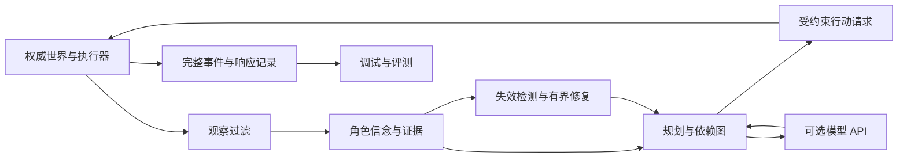

**界行：项目总规划 v0.1**

日期：2026-10-07。状态：设计基线，待实现、待实验验证。已确认条件：单人，普通 CPU 笔记本，无需本地大模型，可使用付费 API。未确认条件：具体 CPU/内存、技术栈熟练度、每周工时、API 金额上限及目标岗位 JD。以下据此采用可调整的默认选择，不把未知条件当作已满足。

**交付顺序更新：先用 AI 辅助开发在两周内发布收敛的 v0.1，再扩展本文所述完整项目。首版范围、工期与版本编号以 [两周上线计划](07-两周上线计划.md) 为准。本文的完整 1.0 功能不是首版上线前置条件。**

**1．项目的目标与价值。**

建立一个可嵌入小型游戏或研究环境的 NPC 行动运行时，使角色在有限观察、资源竞争、持续世界变化下完成多步目标。它应具有明确的动作语义、可修复计划、失败退路、可审计观察和可重放轨迹，并通过独立实验说明有效范围。

核心研发问题是：当 NPC 的当前计划因新观察或可感知失败而失效时，如何判断哪些步骤受到影响，补充必要观察，在给定计算预算内修复计划，同时尽量保留既有行动投入和向其他角色作出的承诺？

它服务两类使用者：游戏开发者使用运行时构建会做事的角色；研究者使用场景、对照策略和评测工具研究动态环境中的规划恢复。玩家端通过角色的移动、生产、运输、维修和协作感知效果。自然语言是设定意图和解释行为的入口，成功判定依据实际世界效果。

项目完成时应支持：给角色设定“在约定时间前提供药物”这样的目标；玩家改变资源或路线；角色根据可获得的证据发现问题、选择替代路径、询问或观察、处理资源冲突；最后呈现完成、延期、失败或无法判断的明确状态。

**2．什么构成项目的创新。**

创新分为机制、工程和评测三层，均需实验后才能得出结果。不能仅因多个已有组件组合在一起，就声称论文级首创。

| 候选贡献 | 具体设计切口 | 必须提供的证据 | 被否定后如何处理 |
|---|---|---|---|
| 受观察约束的依赖失效检测 | 每个计划条件关联角色可见证据、来源与时效；隐藏变化不得直接进入决策 | 同观测历史的成对世界测试；与普通状态图修复比较 | 若只有接口工程收益，按运行时规范与测试贡献报告 |
| 面向承诺与资源冲突的有界修复 | 修复边界同时考虑因果、资源、时间及已接受工作单；先守硬约束再减少变更 | 同一规划器全量重规划、直接修复、逐项消融；成功率与总成本联合比较 | 修复不总占优，报告适用扰动范围和回退规则 |
| 可重复的游戏恢复评测 | 分离世界真相、角色证据、策略输入、模型响应及执行轨迹；多种时钟协议 | 公开场景格式、基线、完整轨迹和独立适配检验 | 外部场景失败时收窄适用域，不删除不利结果 |

最接近的前例必须正面承认。GAVEL 已研究显式世界图、动作验证和部分修复；BRACE 已研究预算内重规划；ROBUST TAMP 已将可见状态和事件触发规划结合。因此，“图＋校验＋局部修复＋按需调用”不是本项目独有的主张。本项目选择游戏中的多角色资源和承诺依赖、证据边界、可复现实验作为切口，差异能否成立仍待具体比较。[GAVEL](https://arxiv.org/abs/2609.19315)、[BRACE](https://arxiv.org/abs/2608.01428)、[ROBUST TAMP](https://arxiv.org/abs/2608.28075)

详细前例、伪代码与保证边界见 [算法与创新验证](03-算法与创新验证.md)。预期最终可以形成方法报告或论文投稿材料，但不把发表论文作为项目完成的必要条件，也不承诺研究结果优于已有工作。

**3．完整 1.0 的六类交付。**

| 交付 | 1.0 必须具备的能力 | 可独立使用的方式 |
|---|---|---|
| 运行时 SDK | typed 观察、目标、动作、计划、结果；执行循环；策略替换；本地预算 | Python 包与示例宿主程序 |
| 恢复算法 | 依赖追踪、局部修复、剩余计划检查、观测/等待、全量回退 | 对同样输入替换规划策略 |
| 参考世界 | 有限离散状态、耗时动作、资源流转、并行 NPC、玩家扰动、存读档 | 无窗口命令与交互演示 |
| 调试工作台 | 世界与角色视图、计划差异、证据来源、时间线、回放与成本 | 本地浏览器工具 |
| 评测套件 | 确定性语义测试、机制组合场景、强基线、消融、统计与资源报告 | 无 API 的离线测试及可选在线实验 |
| 最小外部适配 | Godot 2D 宿主承担一组真实交互语义，运行时通过协议驱动 | 参考适配器与契约一致性测试 |

10–20 名逻辑角色是 1.0 的目标工作负载；全部启用高频 LLM 不作为要求。原型只需三名角色，其他竞争者可以采用明确的脚本或规则策略。1.0 才扩展持续并行任务与受限的工作单协作。所有容量、时延及内存目标必须经本机标定。

完整性定义为：能从设置目标、观察、规划、行动、失败、修复一直走到判定和回放，并且组件有可复用接口、错误处理和验证。大量人物设定、地图面积或支持模型数量都不作为完成标准。

**4．明确的功能需求与追踪关系。**

| 编号 | 需求 | 对应证据 | 首次阶段 |
|---|---|---|---|
| FR-01 | 权威世界唯一写入者，转移原子化，消耗/产出有账本 | 守恒、并发争抢与重复命令测试 | P0 |
| FR-02 | 动作含开始、执行、结束、中断及已发生效果 | 各阶段扰动与取消案例 | P0 |
| FR-03 | 角色只收到自身可观察的信息 | 成对世界、元数据泄漏与错误消息测试 | P1 |
| FR-04 | 维护证据来源、时效与三值条件判断 | 过期、矛盾证据、未知条件案例 | P1 |
| FR-05 | 相同接口下支持规则、完整规划和模型辅助规划 | 策略替换及强基线报告 | P1/P2 |
| FR-06 | 局部修复后检查剩余计划，超过预算回退 | 资源、时间、循环等待及回退案例 | P3 |
| FR-07 | 多角色承诺可接受、履行、拒绝、撤销和到期 | 角色间依赖、消息延迟和履约报告 | P4 |
| FR-08 | 异步模型回包不能覆盖过期目标或计划 | 延迟、乱序、重复回包、超时测试 | P2 |
| FR-09 | 状态、事件、随机流、模型响应能记录和回放 | 事件重放与执行重放校验 | P0/P2 |
| FR-10 | 可暂停、单步、干预和比较计划版本 | 调试工具的任务式演示 | P0–P6 |
| FR-11 | 场景格式、基线与统计结果可重复运行 | 冻结评测清单、原始结果和报告 | P3–P6 |
| FR-12 | 引擎适配能发现模型与真实执行差异 | Godot 动作契约及延迟回执测试 | P5 |

**5．系统的基本边界。**

权威状态 S 是世界实际发生的事，观察 O 是角色获准获得的事实，信念 B 是角色根据观察维护的认知。三者不同。未知不等于不存在，消息过期也不意味着消息必然错误。动作执行的可靠性来自权威层检查；认知层不承诺永远知道真实情况。

首版使用线性执行队列，并用有向无环图记录步骤之间的依赖；多角色可以并发执行，但单个角色不同时进行多个占用身体的动作。时间离散化，动作持续整数 tick；未来可增加更复杂约束，当前不实现完整连续物理或通用部分可观测决策求解器。

模型只能返回受限目标或候选技能序列，不生成并执行任意代码。动作参数必须引用角色已知实体，不能通过全局实体列表获得隐藏信息。执行器可以拒绝失败动作，但给角色的失败描述只包含其能够感知的原因。全局日志与调试真相由独立的管理路径读取。

图中调试与评测的数据不可回流到角色策略。API 输入由角色已知信息构造。开发代码内的隔离依靠接口、模块边界和测试；这不是执行不可信第三方代码的安全沙箱。

**6．项目中 AI 的作用与非训练路线。**

模型用于理解未见的目标表述、选择已有技能、提出任务分解与可行备选；符号层负责明确规则下的搜索、验证和执行。目标和计划由运行时组合，不为每条完整流程手写剧情脚本。

应分别检验两件事：恢复机制是否有效；LLM 是否比不使用模型的策略增加能力。若符号规划足够好，诚实保留其优先地位。项目的 AI 研究也包含规划、搜索、部分观察和多智能体协作，不能把 API 调用数量当成智能程度。

GPU 相关扩展独立放到 1.0 之后：审核恢复轨迹、构造训练数据、训练轻量动作排序器或蒸馏高层策略。届时保留同一场景与验收标准，不让训练成为当前主线的前置条件。

**7．不进入 1.0 的内容及扩展顺序。**

1. 连续三维操作、截图理解、语音和表情不进入首版；以结构化动作研究决策恢复。
2. 完整动态剧情编译、大规模模拟 LOD 属于先前的其他项目方向；仅预留目标/事件接口。
3. 通用经济系统、无限资源制造、大地图编辑器、多人联网服务不进入 1.0。
4. 跨 NPC 协作限定为显式工作单及资源交接，保持可验证；自由社交和群体涌现可后续独立研究。
5. 网络商业游戏接入、厂商内部生产可用性、通用游戏 Agent 能力不在当前证明范围。

完成后优先扩展第二个独立领域，再扩大角色数量，然后考虑更多引擎，最后才考虑训练或视觉。每次扩展必须新增可回答的研究问题。

**8．进度与决策门槛。**

约 180–240 小时完成 P0–P3 的研究原型；P4–P6 补齐多角色协议、外部适配、独立评测与发布质量，完整 1.0 基准工作量约 360–510 小时。以每周 15 小时换算为 24–34 周，另建议留 20% 返工缓冲，即约 29–41 周。这些是任务拆分估算，不是交期承诺，也不包含从零学习编程。

阶段能否通过由交付和证据决定。工程合格与研究优越性分开：即使没有稳定超过强基线，也可以交付可靠的运行时、基准和适用范围报告；若核心观察隔离或执行语义不成立，就不能用精美演示替代修复。

技术栈、目录、任务分解和风险详见 [实施路线](05-实施路线与工程交付.md)；场景与实际展示详见 [场景设计](06-场景与演示设计.md)；收益判定以 [评测与验收](04-评测与验收.md) 的冻结协议为准。
