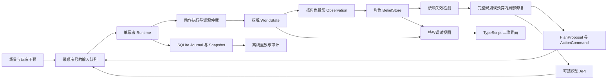
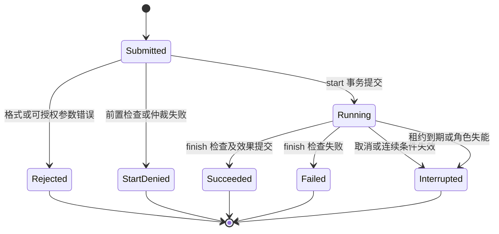

# 界行 NPC 行动运行时：架构与协议

状态：2026-10-07 设计稿；本文件规定未来实现的接口与语义，不代表代码已经存在或性能已经验证。范围为 Python CPU 核心、SQLite 事件存储、TypeScript 轻量二维调试界面；先跑通医生、商人、维修者三 NPC，再扩展到 10–20 NPC。API 仅提议高层计划，可以完全关闭。

主研究问题是：**在相同受限观察和预算下，追踪计划依赖并局部修复，能否减少恢复代价，同时保持任务完成率。** 本项目不求解完整 POMDP，不实现通用游戏引擎，不把“记忆＋工具调用”作为原创贡献。

## 1. 运行边界与数据流

世界拥有真实状态，角色拥有由合法观察形成的信念。二者不是同一个对象的不同字段视图。规划器只拿到序列化的 ActorContext，不能持有 World、数据库连接或调试服务引用。执行器使用真实状态判断动作，但必须通过观察投影器向角色解释结果。



箭头是授权数据通路。没有 `World → Policy`、`Journal → Policy` 或 `Debug → API` 通路。静态地图可以设为公共常识，但道路当前通断、库存及其他角色目标必须明确声明可见性；公共地图和动态通行信息分离。

| 模块（拟定包） | 输入与输出 | 禁止承担的职责 |
|---|---|---|
| `domain` | 实体、谓词、动作定义、整数时间与数量 | 网络、数据库、UI、模型提示 |
| `world` | 内部命令 → 事件批次 → 新世界状态 | 调用模型、替角色形成信念 |
| `perception` | 世界状态和局部感知规则 → 每角色观察 | 暴露全局事件、未感知对象的存在 |
| `belief` | 观察 → 带来源的信念、差量与失效通知 | 用真实状态纠正角色、隐藏地补齐未知值 |
| `planning` | ActorContext → PlanProposal/RepairResult | 获取全局合法动作或真实最短路径 |
| `execution` | 动作请求 → 开始/完成/中断事件 | 修改已提交历史、让模型直接写状态 |
| `runtime` | 时钟、命令、API 回包 → 确定顺序的状态迁移 | 多线程直接修改世界 |
| `persistence` | 事务日志、快照、清单 → 可恢复运行 | 把数据库全量结果提供给角色 |
| `adapters` | 引擎/模型/展示协议转换 | 绕开核心检查、替换权威语义 |

三 NPC 原型中各模块可以同进程，但通过接口限制导入和引用。该隔离是防止工程误用的机制，不是对任意恶意 Python 插件的安全沙箱；v1 不执行模型生成代码、不支持不可信插件。

## 2. 类型约定与权威世界

所有协议含 `schema_version`。标识符为字符串，不能把数据库自增 ID 当角色可见实体 ID。逻辑时间为非负整数 `tick`，数量、费用微单位和格子坐标为整数；禁止 NaN、无穷、隐式时区或影响游戏逻辑的浮点坐标。字段顺序不具有语义，未识别的执行字段直接拒绝。

`WorldState` 至少包括：`run_id`、`tick`、内部 `world_revision`、实体组件、物品账本、活动动作、资源预留、待执行定时事件、场景公开规则。实体组件包括位置、能力、库存容器、道路状态与任务对象状态。`world_revision` 和世界哈希只用于内部审计，不能出现在 ActorContext 中。

物资账本区分物品的所有者、位置、数量及显式的生产/消耗原因。转移必须两端同一事务提交；数量不可为负；预留是对既有物品的占用声明，不另算一份库存。生产与消耗须有动作规则和事件依据，不能将“全世界物品数量永远不变”误设为制造场景的不变量。

每次状态变更先在候选副本上产生事件、计算新状态并验证不变量，然后提交 SQLite；提交成功后才发布观察和 UI 更新。单写者是唯一可持有写连接和应用 reducer 的对象。API 工作线程只能投递回包，不能访问写连接。

## 3. Observation 与 Belief：事实、未知和过期

角色收到的观察是有限证据，不是全局事件过滤后的原始对象。`actor_seq` 只统计本角色收到的消息，`knowledge_version` 只随本角色证据/信念变化而变化。禁止暴露全局日志位置、全局更新时间、隐藏实体数量等旁路信息。

```json
{
  "schema_version": "1.0",
  "actor_id": "doctor",
  "actor_seq": 18,
  "received_tick": 120,
  "knowledge_version": 9,
  "observations": [{
    "observation_id": "obs-doctor-18-a",
    "kind": "direct",
    "observed_tick": 120,
    "subject": "bridge-east",
    "predicate": "traversable",
    "value": false,
    "source": {"channel": "vision", "source_actor": null},
    "coverage": {"scope": "bridge-east", "complete": true}
  }]
}
```

`direct` 表示亲眼或动作接触获得的证据，`report` 表示角色实际收到的报告，`self` 表示自身动作/物品反馈。报告的内容可以错误；只能提供报告者声称的时间与来源，不能附上权威真值验证结果。观察投影器以事件发生时的感知条件生成观察，不能用数步之后的位置补发“当时目击”。视觉轮询则以采样时刻为准。

BeliefRecord 字段为 `fact_key`、`value`、`status`、`source_observation_ids`、`observed_tick`、`received_tick`、`valid_until_tick`、`confidence_label`、`belief_version`。`status` 取 `supported/conflicted/stale/unknown`；置信度只使用 `direct/reported/inferred` 等证据标签，不冒充校准后的概率。`valid_until_tick` 是对动态事实的工程时效假设，过期只变为 `stale`，不能自动反转真假。历史事实“在 120 tick 看见桥断”不因时效到期而消失。

同一时刻互相矛盾的报告保留为冲突，后收到的旧消息不能覆盖较新的亲眼观察。当前推断值与全部证据分开保存；v1 采用固定、版本化的更新规则，不让 LLM 随意合并证据。未观察不等于不存在：只有明确具有完整覆盖的货架检查，才能推导“此处没有药品”；视野外没有返回对象不产生负证据。

能力目录只列角色学会的静态动作种类、参数、公开规则和已知对象候选，不能返回基于真实库存、道路或他人预留筛选的 `legal_actions`。候选动作由角色自己的信念生成。查询远处物品、全图实际路径和预留状态都不允许作为免费 oracle；需要走近、检查或实际收到消息。

## 4. Goal、Plan DAG 与修复接口

`Goal` 字段为 `goal_id`、`version`、`owner_actor`、`desired_predicates`、`public_constraints`、`priority`、`deadline_tick`、`status`。目标可以由场景合法授予，但文本不能夹带未授权事实。角色按证据判断是否达到目标；独立评估器可以用真实状态判定成绩，两种判断分别记录。

`Plan` 包含线性执行序列 `execution_order` 和旁挂的依赖有向无环图，节点状态为 `pending/ready/running/succeeded/blocked/cancelled`。边区分顺序、因果支持、资源与时间依赖；v1 每角色同时最多一个前台动作，DAG 用于表达依赖与识别待修复区域，不意味着实现任意部分序调度。编译器从候选节点与顺序约束生成确定的执行顺序，算法首版仅替换其中连续窗口。

```json
{
  "schema_version": "1.0",
  "proposal_id": "proposal-doctor-7",
  "actor_id": "doctor",
  "goal_id": "heal-patient",
  "goal_version": 1,
  "base_plan_version": 3,
  "base_knowledge_version": 9,
  "nodes": [
    {"node_id": "inspect", "action": "inspect", "args": {"target": "clinic-shelf"}},
    {"node_id": "take", "action": "take", "args": {"container": "clinic-shelf", "item": "herb", "quantity": 1}}
  ],
  "edges": [{"from": "inspect", "to": "take", "kind": "order"}],
  "assumptions": [{
    "assumption_id": "a1",
    "fact_key": "clinic-shelf/herb/quantity",
    "relation": "gte",
    "value": 1,
    "status": "unverified",
    "source_observation_ids": [],
    "used_by": ["take"]
  }]
}
```

上述检查可能发现无药，计划可以因此失败；`unverified` 不等于执行许可。生成器可提议依赖，但不能自行保证依赖完整：本地 PlanCompiler 根据 ActionSpec 补充必需的前置条件、资源和时序依赖，检查节点参数、对象知识权限、引用、环和目标关联，拒绝悬空依赖。每个依赖带 `dependency_id`、谓词、取值约束、证据版本、适用阶段、使用节点及来源类型。未来动作效果用生产节点引用表示，不能伪装成已经观察到的事实。

`detect(previous_belief, belief_delta, plan) → Invalidation[]` 只处理角色可见的差量。结果包括 `dependency_id`、`affected_nodes`、`trigger_observation_id`、`reason`（contradicted/stale/conflicted/outcome）、`detect_tick`。隐藏世界变化可以在特权评估中标为“真实失效时刻”，但不触发角色修复。

`repair(context, frozen_prefix, affected_subgraph, budget) → RepairResult` 的预算至少包含 `max_expansions`、`max_candidates`、`max_api_calls`、`max_tokens`、交互保护用 `wall_timeout_ms`。结果取 `patched/full_replan_required/waiting/budget_exhausted/no_plan_found`，附节点增删、保留节点、证据引用及已用预算。`no_plan_found` 是当前信息和搜索范围内未找到，不等于真实世界不可完成。

修复必须保留已完成动作；对运行中动作先走显式中断语义；跨出受影响区域的资源、时间和目标依赖必须复查。修改成功后再次校验完整剩余 DAG；局部修复失败最多按配置回退一次完整规划，随后等待新证据或进入明确终止状态，不能无限修复。验证范围是当前信念与声明的动作模型，不能承诺未来真实状态不变。

## 5. ActionSpec 与动作生命周期

ActionSpec 分成公开能力描述和仅供执行器使用的权威规则。公开部分含 `name/version/parameters/known_rules/duration_model/cancel_policy`；内部还含 `start_checks/continuous_checks/finish_checks/resource_claims/start_effects/finish_effects/interrupt_effects/observation_projection`。条件与效果使用有限谓词 DSL，不接受 Python、SQL 或任意代码字符串。

```json
{
  "name": "repair_bridge",
  "version": 1,
  "parameters": {"bridge": "known_entity", "material_qty": "positive_integer"},
  "duration_model": {"kind": "fixed", "ticks": 6},
  "resource_claims": [{"resource": "bridge.work_slot", "mode": "exclusive", "lease_ticks": 8}],
  "start_checks": ["actor_adjacent", "has_materials"],
  "continuous_checks": ["actor_can_work", "target_exists"],
  "finish_checks": ["still_adjacent", "target_repairable"],
  "start_effects": ["consume_required_materials"],
  "finish_effects": ["set_bridge_traversable"],
  "interrupt_effects": ["release_claims"],
  "cancel_policy": "interrupt_without_material_refund"
}
```

这是内部动作定义的示例，不可原样发给模型。材料在开始时消耗，因此取消不退款；若未来引入可回收半成品，应新增明确的回收动作和物品，不能悄悄回滚。另一个动作 `transfer` 可以在开始时预留物品、完成时原子转移；每个动作必须选择并记录自身语义，不能混用。



`ActionCommand` 字段：`command_id/actor_id/plan_id/plan_version/node_id/action_spec_version/arguments/submitted_actor_tick`。角色身份由调用会话绑定，不能仅相信请求体的 `actor_id`。Runtime 赋予 `accepted_tick/ingress_seq/action_instance_id`。开始成功后保存 `start_tick/due_tick/claims/committed_effect_refs`；动作至少耗时 1 tick，零耗时读取也不能形成无界同 tick 循环。

同一 `(run_id, command_id)` 重试返回原有结果，不重复转移或消耗；同 ID 不同请求内容直接拒绝。所有终态释放预留，终态不得二次完成。长期移动由逐段动作或明确的逐段效果实现，中断时停在最后提交的位置，不传送回起点。模型取消请求、动作物理中断和计划节点取消是三种不同事件。

## 6. 资源竞争、可观察失败与时钟

资源申请一次性全取或全拒绝，不持有半套资源等待其他资源；同一轮按“等待年龄、场景固定优先级、按 run seed 确定的轮换顺序、命令顺序”仲裁，确切比较规则写进版本化配置。年龄只对相同请求签名累计，改变目标或参数重新计算。所有租约有界且默认不自动续期；长动作一开始申请覆盖预计完成时间的租约。该机制减少饥饿，不保证所有动态任务最终获得资源。

预留不是世界不可改变的魔法锁。正常交易尊重预留；场景定义的强制拿取/摧毁可以在同一事务中先撤销受影响预留、记录对应动作中断，再修改物资，避免负库存和仍持有失效预留的动作。此类干预必须是实际规则，不允许测试程序直接改内存字段。

| 内部失败 | 给角色的返回 | 后续行为 |
|---|---|---|
| 未知或不可授权对象 ID | `INVALID_REFERENCE`，不区分不存在和未授权 | 修正请求；不提供对象建议 |
| 近处检查确认缺货 | `PRECONDITION_NOT_OBSERVED` 加“此处未发现物品”的合法观察 | 信念更新、局部修复 |
| 并发申请被拒 | 若交互可感知，返回 `ACTION_UNAVAILABLE`；不返回谁预留、库存余量 | 有界退避或检查 |
| 远处桥断、角色未获知 | 不返回任何失效通知 | 保留旧信念，直到观察或接触失败 |
| 接触时无法通过 | `ACTION_BLOCKED`，附实际可感知的阻碍证据 | 修复路线或调查 |
| 模型超时/预算耗尽 | `DECISION_UNAVAILABLE`，这是角色自身决策状态 | 保留有效动作、规则降级或等待 |
| 数据库提交失败 | 暂停 run，提供操作者诊断，不伪造动作失败 | 恢复持久化后继续 |

内部失败码、详细真值与相关实体仅进入特权日志。尤其禁止远程“试执行”作为预条件探测：动作首先验证可感知的接触/距离条件，只有到达交互阶段才产生相应失败观察。普通失败也可能揭露真实事实，必须将“尝试是否提供信息”作为动作感知模型的一部分。

一次逻辑 tick 固定为以下阶段，全部采用记录的稳定顺序：①纳入本 tick 输入与扰动；②处理连续条件、中断和到期租约；③完成到期动作；④在暂存状态上生成观察与信念变化；⑤接纳此前已产生的策略回复/行动命令，按即将公开的角色上下文检查版本；⑥仲裁并开始新动作；⑦提交本 tick 事件批次并发布观察。完成早于新开始，因此完成释放的资源可在同 tick 被重新申请；租约有效区间为 `[start_tick, expires_tick)`，正常动作须满足 `due_tick < expires_tick`。

角色失效检测、规划和新 API 请求只能在⑦成功提交后，以已发布的 ActorContext 运行，并将结果送入下一 tick 的输入队列。数据库事务期间不等待网络；暂存观察不发给模型、UI 或外部引擎。barrier 模式在已提交 tick 边界等待决策完成，realtime 模式按节拍继续；两者都不允许看到未提交状态。阶段⑥的自身确认随事务发布，角色下一次行动至少在下一 tick，避免同 tick 循环。第一个上下文来自已提交的初始快照。

模拟 tick 表示游戏时间，墙钟使用单调计时只衡量实际延迟与保护超时。提供两种显式模式：

- `barrier`：离线算法比较可在决策点暂停模拟，等待指定回复；等待墙钟和 API 成本仍完整记录。搜索公平预算以展开数、候选数和调用数为主。
- `realtime`：模拟继续，NPC 执行仍有效的动作或等待；回复晚到、玩家变化都可能使提案失效。独立报告玩家真实等待、丢弃率和回退率。

两模式结果不能混报。API 延迟不得既被 barrier 隐藏又声称满足实时体验；离线加速也不等于画面帧率。

### 6.1 工作单与对外承诺

P4 引入显式 `WorkOrder`，字段为 `order_id/version/issuer/assignee/known_target/quantity/delivery_region/deadline_tick/revocation_policy/status`，另含参与双方已知的 `accepted_terms_hash`。目标和对象必须是参与者已知引用；它不包含全局库存或对方私有计划。订单事件只发送给参与者及规则允许的目击者，消息时延写入场景协议。

生命周期为 `proposed → accepted → in_progress → fulfilled`；提议可 `rejected/withdrawn`，已接受订单只能按既定撤销条款或双方协商进入 `cancelled`，逾期则 `expired` 并记录是否构成 `breached`。后者是履约判定，不能把世界已经造成的违约擦掉。不能把简单发送报告当成对方已接受，也不能在修复时默默修改对象、数量或期限。

接受订单形成角色已知的计划约束，不自动锁定全世界物品。需要物理预留的订单，须通过实际可执行且有期限的资源申请；收到的凭证只证明自己的申请状态，不暴露他人的库存。承诺依赖有方向：商人承诺运输，医生收到后可以计划等待交付，但药材在真正交付前仍为预测效果。

任务条件变化到无法履行时，角色可以提出撤销或重新协商；在结果到达前，原条款仍然有效。超出期限后运行时如实记录失败，修复器返回请求协商、终止或未知，不能借“硬约束”之名让模拟停止或无限规划。正常动作申请仍遵循先前的原子资源与有界租约规则。

第一版不进行开放式合同谈判。双方使用有限字段和明确状态机；LLM 可建议提议，接受规则和订单效果由协议执行。承诺是否提升局部修复效果通过移除承诺依赖的消融验证，不能把更多角色对白作为证明。

## 7. 异步模型协议与过期回复

模型输入只包含 ActorContext：静态能力、本角色证据、目标、剩余计划、已知地图、预算和响应 schema。request 保存 `request_id/actor_id/goal_version/base_plan_version/context_digest/decision_generation/requested_tick/accept_until_tick/wall_timeout_ms/prompt_version/model_config`。`context_digest` 只计算实际发送给模型的角色可见语义快照，不包含全局状态哈希。

每角色最多一个在途决策请求；请求创建后已提交计划被替换、目标修改或取消，都递增 `decision_generation`。v1 采用保守过期规则：所发送证据或自身动作状态改变、出现新的决策相关观察、时效条件跨界，均使该请求过期；单纯 tick 推进但没有时效变化不改变 context。未知世界变化不能单独使请求过期，否则丢弃本身成为隐状态通知。

回包只是一条输入记录。接收顺序为：检查 request/generation 与截止时间 → JSON 和大小限制 → 对当前 ActorContext 重验提案 → 本地 PlanCompiler → 计划版本比较后提交。使用信念校验通过，也仍需在真正动作开始时接受权威检查。旧回复记录为 `discarded_stale`，不能覆盖新计划；不拿它触发无限重试或自动增加预算。

保守规则可能在繁忙场景频繁丢弃，这应报告为局限并计量。后续才能研究“声明依赖读集＋本地补全依赖”的兼容接纳；v1 不相信模型自己声明“没有受影响”。运行中进程崩溃后，尚未收到的 API 请求标为 `abandoned_on_restart`，默认不自动重发；已发送请求可能仍被供应商计费，运行清单要保留未知费用状态。

## 8. 日志、事务、快照与重放

建议 SQLite 表：`runs` 保存版本、种子与配置；`journal` 保存全序事件；`command_receipts` 保存去重结果；`snapshots` 保存恢复点；`model_calls` 保存脱敏请求/回复、版本与用量。Actor 观察与信念迁移同样进入 journal，但以 audience 标记；这个标记用于导出控制，不能代替独立的 ActorView 生成器。

内部 JournalEvent 字段：`run_id/seq/tick/phase/type/schema_version/causation_id/correlation_id/audience/payload/previous_hash/event_hash`。`audience` 为 `internal/debug/actor:<id>`；actor 通路重新封装本地序号，不直接序列化 JournalEvent。模型原文可能包含密钥外的数据泄漏，API Key 永不写日志，认证头不记录。

单 tick 的事件、命令收据和可选物化状态在一个显式事务提交。SQLite 的单写者与原子事务用于保证同库内一致性；网络调用在事务之外。写连接固定线程并显式配置事务行为，不依赖未来可能变化的默认值。初期使用默认日志模式即可，调试器读内存投影；只有实测出现读写需求后再评估 WAL。SQLite 官方说明其写入需要串行化，Python 官方文档也要求开发者注意事务及连接线程语义。[SQLite 隔离说明](https://www.sqlite.org/isolation.html)、[Python sqlite3 文档](https://docs.python.org/3/library/sqlite3.html)

快照只能取已提交 tick 边界，内容包括世界、活动动作/租约、所有角色信念与观察游标、计划/目标版本、定时队列、去重游标、随机发生器状态以及在途请求元信息。必须带最后事件序号、schema/reducer/action catalog 版本、配置哈希与状态哈希。恢复后从下一事件继续；缺失的网络连接不会被快照恢复。

提供两种重放，明确其证明力度：

1. **事件重建**：应用已提交领域事件，验证最终世界与 Actor 状态哈希一致；它证明日志足以恢复状态，不能单独证明规划算法正确。
2. **输入重执行**：从初态重新运行 reducer/调度/策略，注入原记录的扰动、API 回复/错误及其接纳 tick、顺序、超时输入，对照事件和状态哈希；版本不同则作为对比试验，不冒称同版本确定性回放。

相同提示重新调用 API 不属于回放。影响分支的外部墙钟超时、随机结果、用户输入和响应顺序都须录制。序列化使用版本化规范：UTF-8、键排序、整数值、禁止非有限数字、集合先排序；协议 ID 是 ASCII，内容字符串按约定保持原样。状态哈希排除显示时间和性能计时等非逻辑字段。一次崩溃只恢复已提交事务；禁止先显示成功再补写持久化。

在旧快照上继续操作必须创建新的 `run_id`，记录父 run 和分叉序号，不修改旧日志。快照格式迁移须独立版本和显式迁移记录；不兼容 reducer 不能静默重放。

## 9. Actor、Debug 与外部引擎接口

Actor API 只允许 `observe(after_actor_seq)`、`submit_action(command)`、`propose_plan(proposal)` 和读取自身已知状态。Debug API 才能读取全世界、因果日志和所有信念；UI 切换“角色视角”必须真正请求受限投影，不能仅隐藏画布图层。调试权限、模型权限和玩家干预权限使用独立会话能力标识；仅绑定 localhost 仍不等于权限隔离。角色请求体不接受 `debug=true` 之类升级开关。

可见性审计除字段检查外，还应构造两份仅隐藏状态不同、角色观察相同的世界：在合法接触新信息前，ActorContext、模型请求、依赖通知与候选动作应相同。实际动作接触环境后的差异可以合理出现。日志事件 ID、错误长度、世界版本和全局事件计数都应纳入旁路检查；不承诺消除同机计算时间等所有安全侧信道。

外部引擎以可替换 WorldAdapter 接入：`initialize(spec)`、`observe(actor_id, cursor)`、`submit(command)`、`poll_results()`、`step(ticks)`、`snapshot()`、`restore(snapshot_ref)`、`capabilities()`。其中 `debug_state()` 是独立特权接口，不属于策略适配器。能力表声明是否支持定步、可靠观察、幂等命令、快照与恢复；不支持恢复的引擎只能做轨迹记录，不能假装提供状态重放。

每个 run 只有一个权威来源。自建小城由 Python 核心掌权，二维 UI 只是显示；接入真正游戏引擎时由引擎决定物理动作是否完成，Python 等待确认，不能同时自行提交相同游戏效果。外部调用不存在跨 SQLite 和引擎的天然原子事务，需 command_id、确认/查询协议及恢复对账；v1 不声称外部效果 exactly-once。外部引擎适配应先限定为第二个简单确定性场景，复杂三维引擎是后续工作。

## 10. Windows 单机执行路径与依赖

未来目录按 `src/jiexing`、`scenarios`、`web`、`runs`、`tests` 分离。核心标准库优先，使用 `dataclasses/enum/heapq/json/hashlib/sqlite3`；异步 I/O 可用标准库 `asyncio`，有阻塞网络调用时在线程中执行并向 runtime 投递数据。[asyncio 官方文档](https://docs.python.org/3/library/asyncio.html)

TypeScript 仅负责 Canvas 二维绘制、时间轴、角色信念/计划和重放控制。初版使用浏览器原生 API 与轮询读取已提交投影；不先引入 React、WebSocket、Redis、向量库或复杂图数据库。开发时用项目本地 TypeScript 编译器并锁定版本；发布可随包附构建产物，使纯 Python 用户无需 Node 即可看演示。[TypeScript 官方工具说明](https://www.typescriptlang.org/docs/handbook/typescript-tooling-in-5-minutes.html)

以下是拟定命令契约，当前尚不能执行；具体入口名称在实现阶段固定：

```powershell
py -3 -m venv .venv
.\.venv\Scripts\python.exe -m pip install -e .
.\.venv\Scripts\python.exe -m jiexing run --scenario clinic --policy rule --mode barrier
.\.venv\Scripts\python.exe -m jiexing serve --run runs\clinic-001
.\.venv\Scripts\python.exe -m jiexing replay --run runs\clinic-001 --verify
```

不依赖 PowerShell 激活脚本、Docker、WSL、CUDA 或本地大模型。运行前诊断记录 Python/SQLite 版本、CPU、内存和权限；数据库与缓存使用项目内明确目录。API Key 从环境变量读取且脱敏；默认离线策略能完成所有协议与恢复验证。HTTP 展示服务只在本机运行，后续远程服务化需要单独设计，并非 v1 交付要求。

## 11. 架构决策记录与实现退出条件

| ADR | 决定与理由 | 代价/重新评估条件 |
|---|---|---|
| 001 | 单写者＋整数 tick；先明确因果顺序 | 不追求多核仿真吞吐，实测瓶颈后再讨论并行 |
| 002 | 世界、观察、信念三层分离 | 多出投影逻辑，但可公平比较受限观察策略 |
| 003 | 静态能力目录＋信念候选；不提供真值合法动作列表 | 会有合理失败尝试，成功率不可能靠过滤作弊 |
| 004 | DAG 与有限动作 DSL，不采用完整 POMDP | 不提供最优信念规划与任意连续控制 |
| 005 | 原子资源申请、有界预留、明确开始/完成效果 | 规则较严格，不能模拟任意多人协作动作 |
| 006 | API 为可选提议者，保守过期检查 | 在线可能丢弃过多回复，先量化再放宽 |
| 007 | SQLite 全序日志＋已提交边界快照 | 调试数据体积增加，v1 先分 run 留存，不删掉复现所需输入 |
| 008 | 录制模型输出才能重放 | 无法承诺不同供应商或新模型版本重现同样策略 |
| 009 | 自建世界与外部引擎分别选唯一权威 | 外部恢复与幂等能力不能由 Python 单方面保证 |
| 010 | TypeScript 原生二维界面、Python 核心独立运行 | 展示较朴素；避免 UI 复杂度吞没研究投入 |

三个 NPC 原型进入算法研究前，必须能够用离线策略演示：一份资源并发请求不会重复消费；材料已消耗后的取消不会退款；远处桥断不会提前通知角色；角色获得新证据后依赖才失效；过期 API 回复不会覆盖新计划；保存、恢复和两种回放的语义可区分；调试窗口关闭后实验仍可运行。扩展至 10–20 NPC 前先记录上述条件在多轮扰动中的结果，不能仅凭演示视频验收。

本文件的动作生命周期、事件记录、资源预留、依赖图和事务均采用已有工程思想。Generative Agents 已有记忆与规划，Voyager 已有可执行技能和反馈；本项目拟贡献的是这些约束下**失效依赖的选择、局部修复边界和预算策略的实证结果**，不是给常见架构重新命名后主张原创。[Generative Agents](https://arxiv.org/abs/2304.03442)、[Voyager 官方仓库](https://github.com/MineDojo/Voyager)
